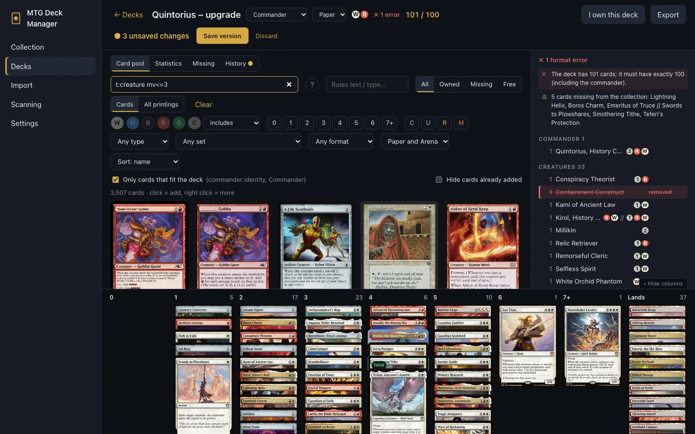
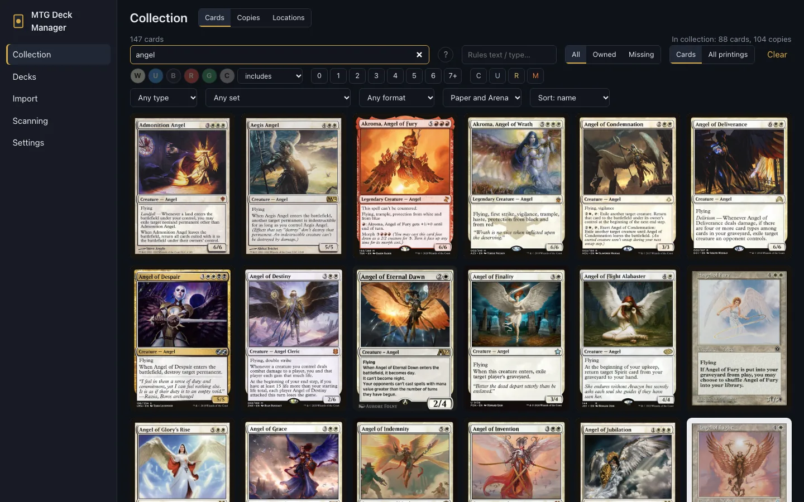
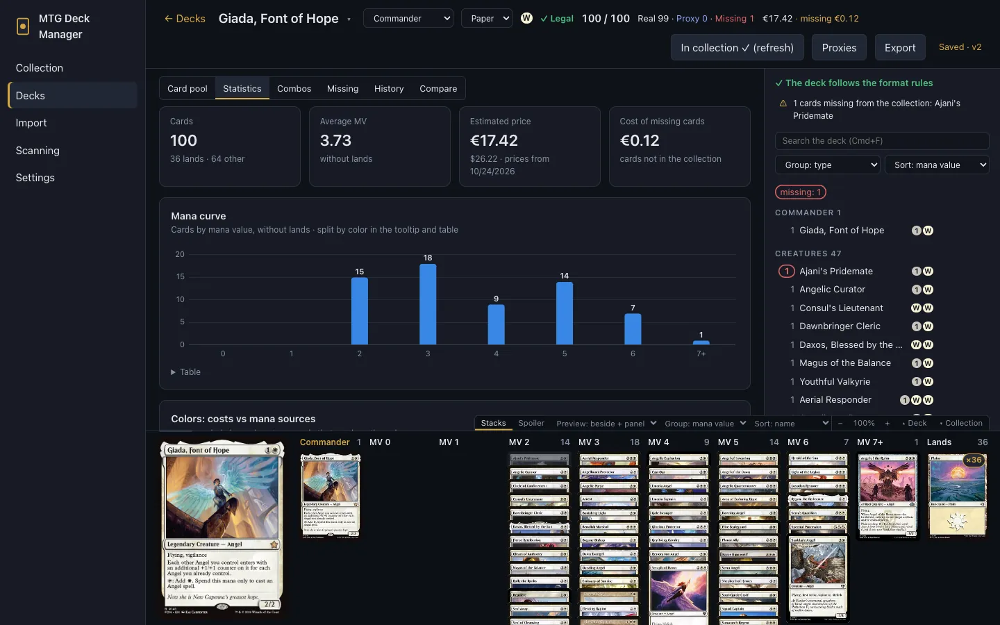
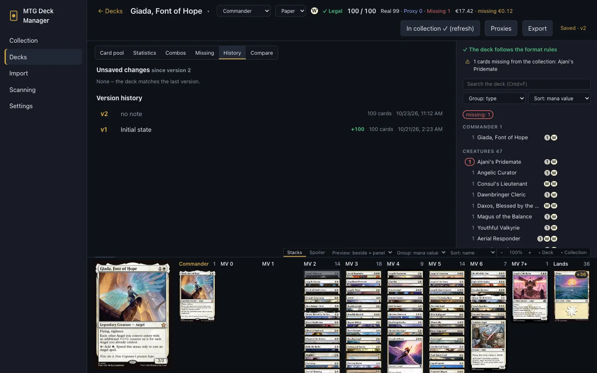
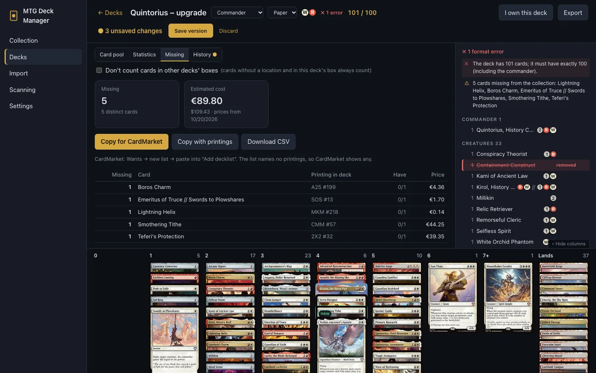
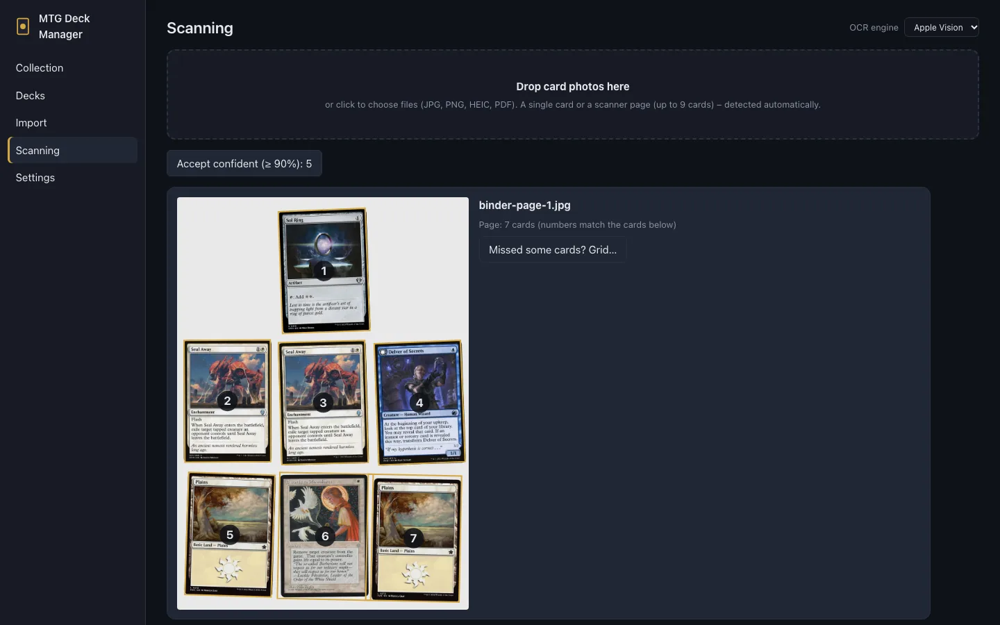
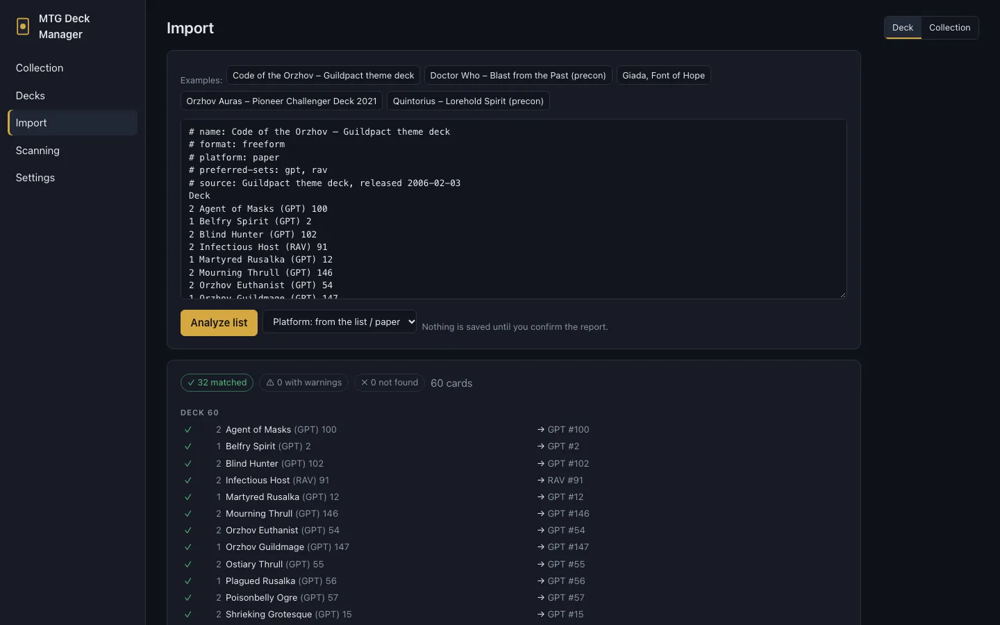
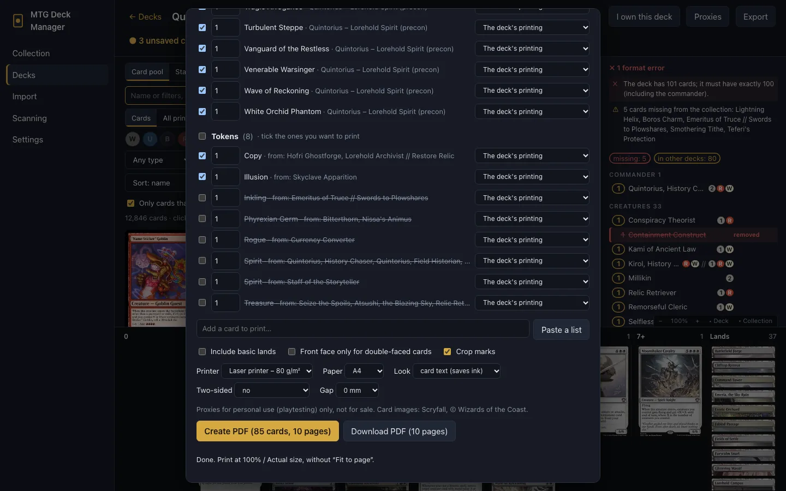
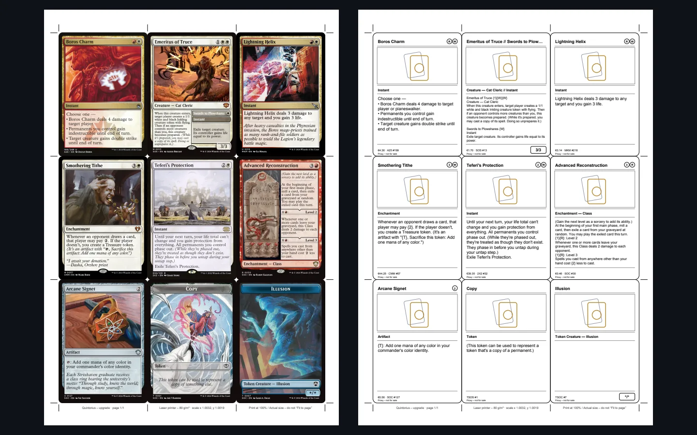
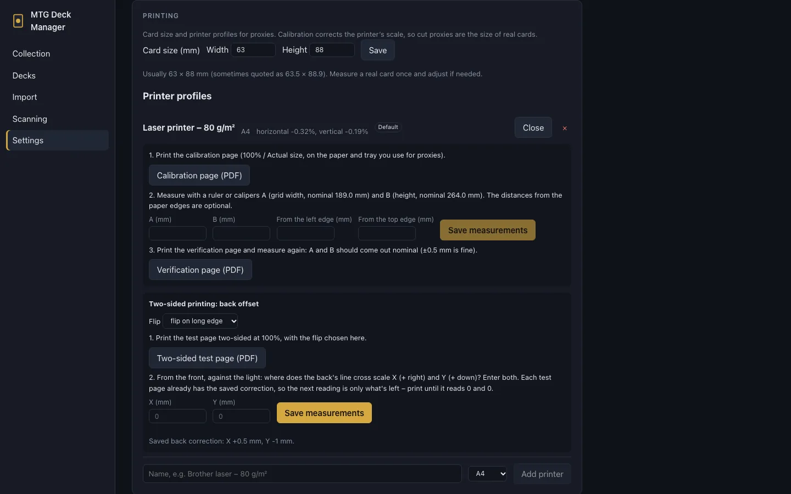

[](https://github.com/wjaros/mtg-manager/actions/workflows/build.yml)

# MTG Deck Manager

A local desktop app for Magic: The Gathering players with a paper collection and an Arena account:
keep track of your cards (by scanning them), build and validate decks, see what a deck still needs,
print proxies of the cards you're missing, and export decks to MTG Arena, Moxfield or a
phone-friendly PDF. Everything runs on your computer; card data comes from
[Scryfall](https://scryfall.com) and works offline once downloaded.

**User guide** with screenshots: [English](docs/en/index.md) · [Polski](docs/pl/index.md)



## Features

**Collection.** Every card printing from Scryfall, searchable by name or with Scryfall-style filters
(`t:angel mv<=3 id:wr`). Physical copies with printing, finish, language, condition and location
(binders, boxes, deck boxes). Open any card and you see where each of your copies lies, e.g. "1×
DOM #31 · NM · Giada, Font of Hope" means it sits in that deck's box, so you know where to take it from. A
card you own shows the printing you have the most copies of, here and in the deckbuilder's pool (paper decks).
Filter the search to the cards you own or to the ones you're missing. A word that is a card type
(e.g. "desert") searches names, as on Scryfall, so the search offers `t:desert` for the type line.
Right-click a card to copy its name, or use the copy button in its details.
Tag cards your own way (right click → *My tags…*: "wincon", "pet card"…) and search them with
`tag:wincon`.



**Deckbuilder.** Arena-style deckbuilder for Commander, Brawl, Standard Brawl, Historic, Standard,
Pioneer and freeform decks:
- the card pool shows only cards that fit the deck (commander identity, format, Arena availability);
- format validation runs as you build;
- mana value columns;
- statistics: curve, colours, types, categories, card functions (ramp, draw, removal, board wipes…
  from Scryfall's tags) and the price of what's missing;
- search by function like on Scryfall (`otag:ramp`) or with the *Function* filter.
- *Similar cards* (right click on a card): cards doing the same job, by rules text, Scryfall's tags
  and mana value, those you own first; in the card's colours, more can be switched on.

Hovering a card shows how many copies the deck has, how many you own and where they are (e.g. in
another deck's box). Singleton duplicates are greyed out.



**Combos.** The *Combos* tab lists combos the deck has and those one card away, from
[Commander Spellbook](https://commanderspellbook.com), with the steps; the missing card is one click from the deck.

**Version history.** Decks save as you edit. *Save version* takes a snapshot, and everything since
the last snapshot is highlighted: added cards in green, removed ones struck through in red, swapped
printings in yellow. You can compare versions, restore one or discard unsaved changes.



**What's missing.** In a paper deck, each card's quantity is coloured by where its copies are:
- *missing*: you don't own enough copies;
- *in another deck*: your copies sit in another deck's box (the tooltip names the deck);
- *not in box*: you own it, but it isn't in this deck's box.

Missing cards are greyed out in the mana columns. The *Missing* tab lists what to buy, with
estimated prices. Copies built into your other decks can count as unavailable, so the list covers
having both decks at once. Copy the list into a CardMarket wants list or download it as CSV.



**Shopping list.** *Collection → To buy* gathers what to buy across decks: a deck's missing cards
(one click in its *Missing* tab) and any card you right-click in the search or a deck. Copies you
add to the collection afterwards count as bought and drop off the list. Copy it into a Cardmarket
wants list and let its Shopping Wizard find the sellers (e.g. the fewest shipments), or download
it as CSV.

**CardTrader.** With your CardTrader API token (from your CardTrader profile settings, added in
*Settings → CardTrader*), *Send to CardTrader* keeps one private CardTrader wishlist in step with
the shopping list (any printing); from a deck's *Missing* tab, its missing cards go on the shopping
list first. Each send replaces the wishlist, so take cards off the shopping list here rather than on
CardTrader. Cards CardTrader doesn't recognize are listed, so you can add them there by hand. The
cards' language can be set in *Settings → CardTrader* (any by default). The
token stays on your computer and is never part of a backup.

**Scanning.** Drop photos of single cards, flatbed scans of whole pages (up to 9 cards, e.g. a binder
page) or PDFs. Cards are found, straightened and recognized by name, collector line and art. You
review the result and choose finish, condition and location before anything reaches the collection.



**Import and export.**
- Decklists: paste from MTG Arena or Moxfield, with a match report before saving (exact printings,
  warnings, suggestions), or find an official preconstructed deck by its name, its commander or
  set code (lists from [MTGJSON](https://mtgjson.com), downloaded with the card data). *Import →
  Precons* lists the Commander precons with their colors, how much of each you own and the cards'
  value; a deck's *Missing* tab names the precons that contain several of its missing cards.
- Collections: product contents as a card list, or Moxfield's collection CSV.
- Exports:
  - MTG Arena (printings that aren't on Arena are swapped);
  - Moxfield collection CSV;
  - Arena-style lists and CSV;
  - a deck as a PDF with one card per page, for browsing on a phone;
  - a full JSON backup.



**Proxy printing.** From a paper deck, *Proxies* lists the cards you can't put in its box: the ones
you don't own and the ones sitting in another deck's box (with that deck's name), plus the tokens
the deck makes. Pick quantities and printings, add any card by hand, and get a print-ready PDF:
- 3 × 3 card-size proxies per A4 or Letter page, with crop marks;
- card images from Scryfall, unaltered, or *text proxies* to save ink: name, mana cost, type,
  rules text, stats and price in a thin frame, with the app's logo where the art would be;
- two-sided for duplex printers: a double-faced card's other face on the back, other cards get
  the app's own card back.

Any other cards or tokens print from *Collection → Print proxies*: pick them in the card grid
(*Pick for printing*, or right click), search for them or paste a list.





Printers scale and shift pages slightly. *Settings → Printing* calibrates each printer:
- print a calibration page and measure two lengths with a ruler: later prints come out at real
  card size, so cut proxies fit sleeves;
- for two-sided prints, a test page shows how far the printer puts the back off the front (read
  against the light on a 0.5 mm scale), and backs are moved to match.

After printing from a deck, the app offers to record the cards as proxies in the deck's box. A
proxy is part of the deck but never counts as a card you own:
- the deckbuilder marks proxied cards with a PROXY chip, and the header shows
  `Real · Proxy · Missing` (adding up to the deck's size);
- the *Missing* tab lists proxied cards apart, as "covered by proxy – to buy";
- *Collection → Proxies* lists every proxy with its deck and whether you own the real card by now:
  replace it with the real card after buying one (or move in a loose copy you have), move, remove
  or print it again; past prints can be marked or printed again too.

Proxies are for personal playtesting only, not for sale.



The interface is in Polish and English (Settings → Language).

## Install

Download the latest build from [Releases](https://github.com/wjaros/mtg-manager/releases):

- **macOS:** `…-arm64.dmg` for Apple Silicon (M1–M4), `…-x86_64.dmg` for Intel. The app is not
  notarized: open it the first time with right click → Open.
- **Windows:** `…-windows-x64.zip`. Unpack it and run `MTG Deck Manager.exe` (needs the Edge
  WebView2 runtime, built into Windows 11 and current Windows 10).

On first start, open **Settings → Download card data** (about 80 MB; the import takes 2–3 minutes).
Refresh it now and then: the app suggests it when Scryfall has newer data.

New versions: on start the app checks GitHub (at most every few hours) and, when a newer release is
out, shows what's new and a download button for your system; *Skip this version* stops the reminders
until the next one. The check can be turned off in *Settings → Application*. There's no automatic
install: the macOS app isn't signed, so it can't replace itself cleanly.

## Scanning tips

- **Flatbed scanner:**
  - black-bordered cards with the lid closed (white background);
  - white-bordered cards with the lid open in a dark room (black background);
  - a small gap between cards helps.
- **Missed cards on a page:** use *Missed some cards? Grid…* (rows × columns, optionally over a
  selected area).
- **Photos:** one card per photo, from above, on a contrasting matte background, in diffuse light
  without reflections on the card or sleeve. HEIC (iPhone) photos work on macOS. On Windows, set
  the iPhone to save JPG (Settings → Camera → Formats → Most Compatible).
- **OCR:** Apple Vision on macOS; RapidOCR (bundled models, offline) on Windows and Linux.

## Development

Requirements: [uv](https://docs.astral.sh/uv/) (installs Python 3.12), Node.js.

```sh
cd frontend && npm install && npm run build && cd ..
cd backend && uv sync
uv run mtgdm sync                                  # download Scryfall data (~2 min)
uv run mtgdm app                                   # native window (pywebview)
uv run mtgdm serve --host 0.0.0.0 --port 8765      # or as a web server
```

- Live reload: `scripts/dev.sh`, then open http://localhost:5173 (Vite proxies `/api` to the backend).
- Tests: `cd backend && uv run pytest`. Lint: `uvx ruff check mtgdm tests ../scripts` and
  `cd frontend && npm run lint`.
- Project layout and conventions: [CLAUDE.md](CLAUDE.md).

Stack: Python 3.12, FastAPI and SQLite (FTS5) in the backend; React, TypeScript and Vite in the
frontend; OpenCV and Apple Vision / RapidOCR for scanning; pywebview for the window; PyInstaller
for packaging.

## Building the apps

### macOS

```sh
scripts/build_macos.sh
```

Builds `dist/MTG Deck Manager.app` and `dist/MTG-Deck-Manager-<version>-<arch>.dmg` for the Mac it runs
on. The first build compiles a minimal OpenCV (`scripts/build_opencv.py`): a few minutes, cached in
`build/opencv-slim/`, needs the Xcode command line tools. The app is signed ad hoc for local use.

**Signing for distribution (Developer ID + notarization).** Anyone with an Apple Developer account
can sign and notarize a built app:

```sh
security find-identity -v -p codesigning            # find "Developer ID Application: … (TEAMID)"
xcrun notarytool store-credentials mtgdm-notary --apple-id YOU@EXAMPLE.COM --team-id TEAMID
SIGN_IDENTITY="Developer ID Application: … (TEAMID)" NOTARY_PROFILE=mtgdm-notary \
  scripts/sign_macos.sh "dist/MTG Deck Manager.app" MTG-Deck-Manager.dmg
```

The script does the following:
- signs every binary with the hardened runtime;
- notarizes and staples the app;
- builds, signs, notarizes and staples the DMG.

The result opens on any Mac with a double click. On rejection the script prints Apple's notary log.

### Windows

Needs uv, Node.js and Visual Studio's C++ build tools (for the minimal OpenCV):

```powershell
powershell -File scripts\build_windows.ps1
```

Builds `dist\MTG Deck Manager\MTG Deck Manager.exe` and a zip of that folder.

### CI and releases

`.github/workflows/build.yml` runs the tests on Linux and Windows. For pull requests and releases it
also builds and smoke-tests the macOS arm64, macOS x86_64 and Windows x64 packages
(`scripts/smoke_test.py`); a merge without a new version only runs the tests.

To release, bump `__version__` in `backend/mtgdm/__init__.py` (e.g. in the pull request) and merge
into `master`. When every package has built and passed its smoke test, the build creates the tag
`v<version>` and a GitHub Release with the DMGs and the Windows zip attached; its notes are the
commit messages since the previous release (`scripts/release_notes.py`), so write squash messages
for readers. Pushes to `master`
without a new version release nothing. Pushing a matching tag by hand (`git tag v0.2.0 && git push
origin v0.2.0`) works too.

## Data

The data directory holds the database, image cache, scans and logs:
- macOS: `~/Library/Application Support/MTGDeckManager/`
- Windows: `%APPDATA%\MTGDeckManager\`

Override it with `MTGDM_DATA_DIR`. **Settings → Backup** saves your collection, locations and decks
(with their history) as one JSON file.

**Automatic cloud backup.** In *Settings → Backup*, choose a folder that iCloud Drive, OneDrive or
Dropbox syncs (the app suggests the ones it finds). After every change the app writes
`mtgdm-backup.json` there, with older copies in `history/`; the Scryfall card data stays local. On
another computer using the same folder, the app offers to load newer data written there (its own
data goes to `history/` first) or to keep its own.

## License

Copyright © 2026 Wojciech Jaros. Licensed under the [GNU General Public License v3.0 or later](LICENSE):
you are free to use, study, change and share the app. Anything you distribute that is based on it
must keep this notice and be shared under the same license, with its source code.

Third-party components and data: [THIRD_PARTY_NOTICES.md](THIRD_PARTY_NOTICES.md).

## Legal

Card data and images come from [Scryfall](https://scryfall.com) and follow its API guidelines:
cached locally, never altered. This app is not affiliated with or endorsed by Scryfall.
Preconstructed deck lists come from [MTGJSON](https://mtgjson.com) (MIT License), combos from
[Commander Spellbook](https://commanderspellbook.com).

MTG Deck Manager is unofficial Fan Content permitted under the
[Fan Content Policy](https://company.wizards.com/en/legal/fancontentpolicy). It is not approved or
endorsed by Wizards. Portions of the materials used are property of Wizards of the Coast.
©Wizards of the Coast LLC.
