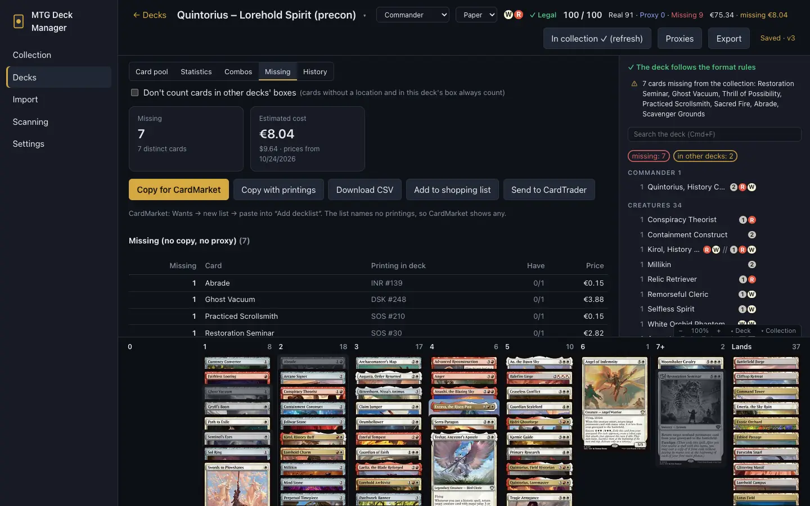
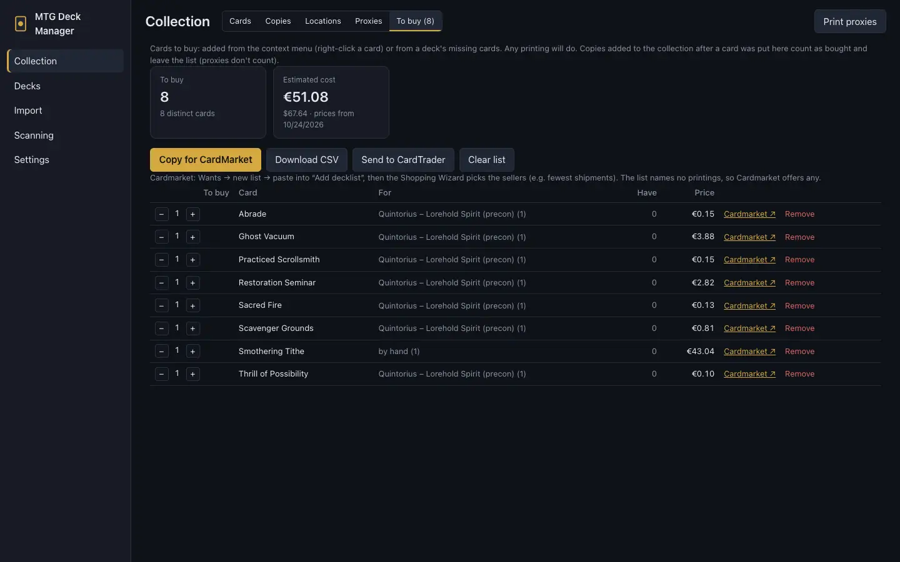
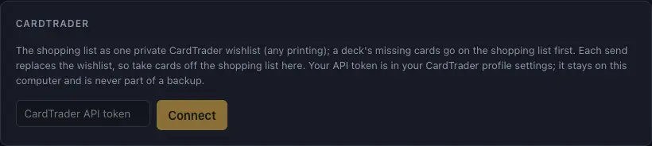

# Missing cards and buying

[← Contents](index.md)

## A deck's missing cards

The deckbuilder's **Missing** tab (paper decks) lists the cards a deck still needs, with estimated
prices:

- **Don't count cards in other decks' boxes:** copies built into your other decks count as
  unavailable, so the list covers having both decks at once;
- cards a proxy stands in for in the deck's box are listed apart ("covered by proxy – to buy");
- at the bottom are the precons that contain several of the missing cards.

Buttons:
- **Copy for CardMarket:** a "1 Name" list to paste into Cardmarket;
- **Copy with printings:** a list with set and collector number;
- **Download CSV;**
- **Add to shopping list** (see below);
- **Send to CardTrader** ([CardTrader](#cardtrader)).

### Cardmarket

1. Click **Copy for CardMarket**.
2. On Cardmarket: **Wants** → new list → paste into **Add decklist**.
3. Cardmarket's **Shopping Wizard** picks the sellers, e.g. the fewest shipments.

The list names no printings, so Cardmarket offers any.

## Shopping list

**Collection → To buy** gathers what to buy across decks:
- a deck's missing cards (**Add to shopping list** in its **Missing** tab). Adding them again
  replaces what that deck added before;
- any card from its right-click menu (**Add to shopping list**).

It goes by card, not printing. The list shows the decks a card is for, the copies you own and an
estimated price. Real copies you add to the collection afterwards count as bought and leave the
list (proxies don't). Reduce or remove entries by hand. Copy the list for Cardmarket, download it as
CSV or send it to CardTrader.

## CardTrader

The shopping list can be kept as one private wishlist on [CardTrader](https://www.cardtrader.com),
updated with one click.

### Connecting (once)

1. On CardTrader, open your profile settings and copy your **API token**.
2. In the app: **Settings → CardTrader**, paste the token and click **Connect**. The app checks it
   with CardTrader.
3. Optionally pick the **Language of the cards on the wishlist** (any by default).

The token stays on this computer: it's never part of a backup or the cloud backup folder.
**Disconnect** removes it. If the token ever leaks, generate a new one on CardTrader.

### Sending

- On the shopping list, click **Send to CardTrader**: the wishlist "MTG Deck Manager – to buy" gets
  the whole shopping list (any printing).
- In a deck's **Missing** tab, the same button first puts the deck's missing cards on the shopping
  list, then updates the wishlist.

CardTrader's API can't edit a wishlist, so each send creates a new one and deletes the previous
one. **Changes made on CardTrader are overwritten**: take cards you don't want to buy (too
expensive, say) off the shopping list in the app. An empty shopping list removes the wishlist.

CardTrader silently drops cards it doesn't recognize. The app reads the wishlist back after sending
and lists those cards, so you can add them there by hand. If the chosen language isn't kept, the
app says so too.
