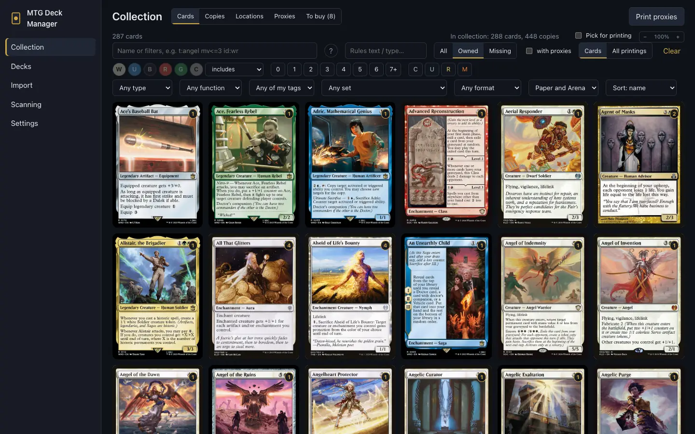
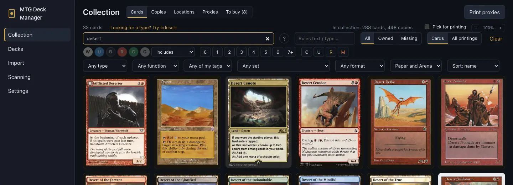
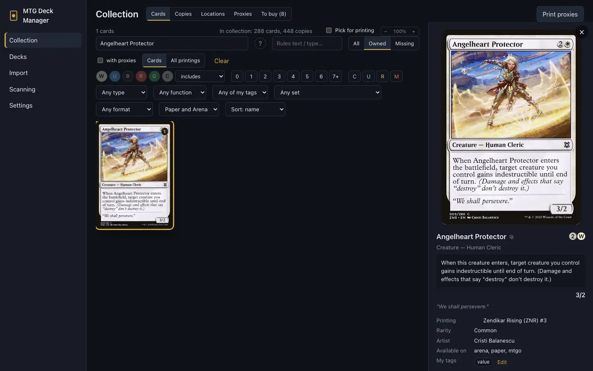
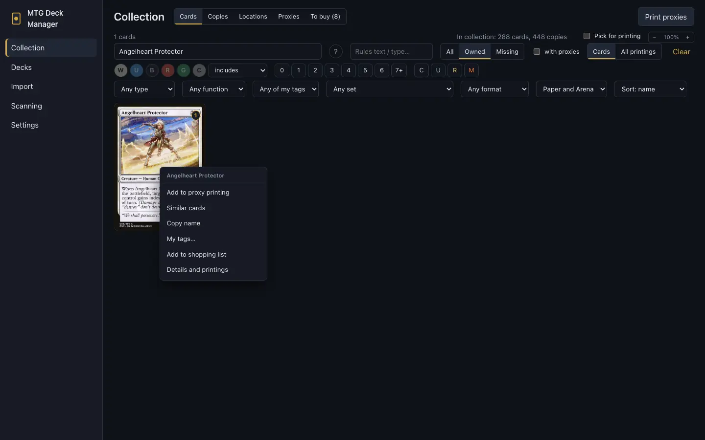
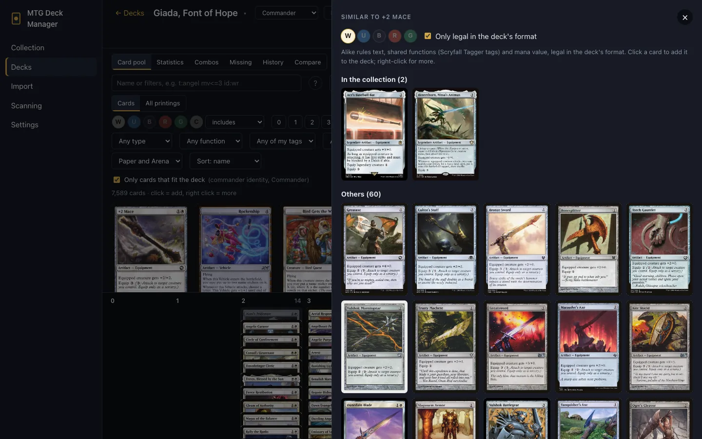
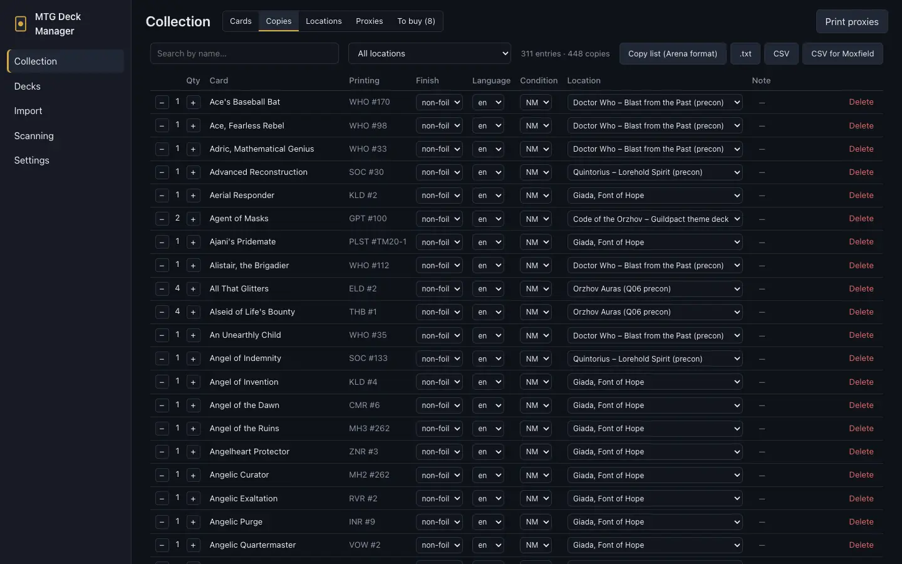
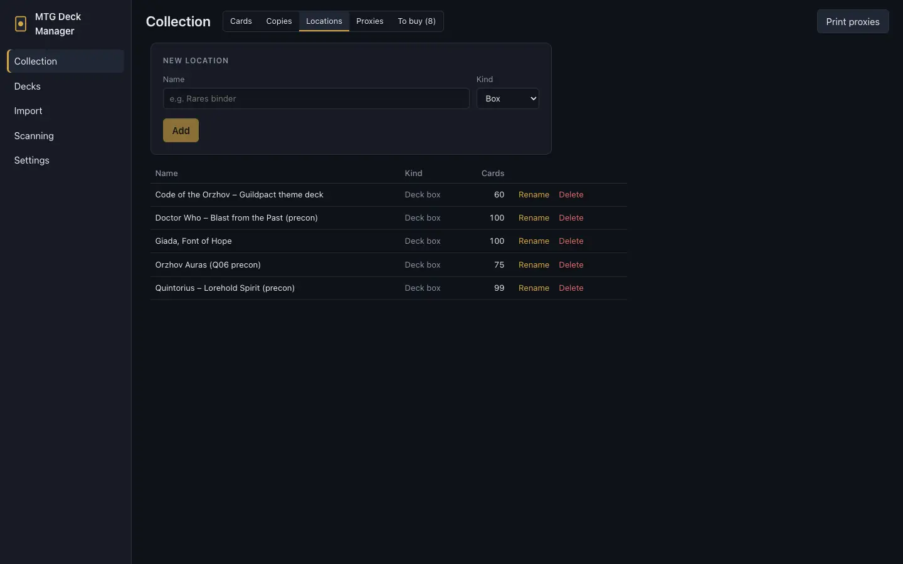

# Collection

[← Contents](index.md)

**Collection** has five tabs: **Cards** (every card from Scryfall), **Copies** (your physical
cards), **Locations**, **Proxies** and **To buy**.

## Search

- The first field takes words of a card's name or filters in Scryfall's syntax, e.g.
  `t:angel mv<=3 id:wr`. The **?** button next to it shows the whole syntax.
- The second field searches the rules text and type line.
- The filters below: colors (with a mode: includes / exactly / within identity), mana value,
  rarity, type, card function, my tag, set, format, game (paper / Arena).
- **All / Owned / Missing:** every card, only yours, or only the ones you don't have.
- **Cards / All printings:** one entry per card, or every printing on its own.
- Sorting and the grid's zoom are on the right.

The syntax you'll use most:

| Syntax | Meaning |
|---|---|
| `t:angel`, `t:creature` | type or subtype in the type line |
| `o:"enters the battlefield"` | rules text |
| `c:wu`, `c=r`, `c:m` | colors: at least / exactly / multicolored |
| `id:wr`, `id<=wr` | color identity within these colors |
| `mv>=5`, `mv=2` | mana value |
| `r:mythic`, `r>=rare` | rarity |
| `s:who` | set (Scryfall code) |
| `f:commander` | legal in a format |
| `otag:removal` | card function (Scryfall tag) |
| `tag:wincon` | your own tag |
| `-t:creature` | a minus negates any filter |

Words without a key search card **names**, as on Scryfall. When you type a word that is a card
type (e.g. "desert"), the app offers the query with a type filter instead; a click applies it.

## Your printing of a card

A card you own shows the printing you have the most copies of (on a tie, the one added last)
instead of the default one. The deckbuilder's pool does the same for paper decks. With printing
filters (set, rarity) and in Arena searches, you see the printing matching the filter.

## Card details

Click a card to open its details on the right:

- the card's image and text, printing, rarity, artist, and an estimated price with its date;
- **your copies and where they are**, e.g. "1× DOM #31 · NM · Giada, Font of Hope" means it sits
  in that deck's box;
- **My tags**, with an **Edit** button;
- all printings of the card;
- the ⧉ button next to the name copies the card's name.

## The card menu (right click)

Right-click a card for its menu:

- **Add to proxy printing** ([proxy printing](proxies.md));
- **Similar cards** (see below);
- **Copy name**;
- **My tags…**;
- **Add to shopping list** ([shopping list](buying.md#shopping-list));
- **Details and printings**.

## Similar cards

**Similar cards** finds cards that do the same job as the chosen card. It goes by:

- alike rules text;
- shared functions from Scryfall Tagger's tags;
- mana value.

Cards you own come first, under **In the collection**, then **Others**. By default only cards
within the chosen card's colors are shown; the W U B R G toggles add more colors.

In the deckbuilder, the list follows the deck's format and leaves out cards already in the deck.
Unchecking **Only legal in the deck's format** shows all similar cards, with those the deck can't
play (its format and, for an Arena deck, being on Arena) greyed out and marked "Not legal in the
deck"; the choice is remembered. A click adds a card to the deck. **Deck's colors** selects the
commander's colors. In [deck comparison](decks.md#comparing-decks) you choose which of the two
decks to search for.

## My tags

Your own tags on cards ("wincon", "pet card", "for the cube"…):

1. Right-click a card → **My tags…** (or **Edit** in its details).
2. Type the tags, comma-separated. The prompt lists the tags you already use.
3. Search them with `tag:wincon` (or `tag:"pet card"`), or with **Any of my tags** in the filters.

A tag belongs to the card, so every printing has it, in the collection and in every deck. Case
doesn't matter, and a tag keeps one spelling: a new "WINCON" takes the "wincon" already in use. The
deck statistics count the cards with each tag ([statistics](decks.md#statistics)). Tags are in the
backup.

## Copies

**Copies** are your physical cards: printing, finish (foil etc.), language, condition, location
and a note. Add them by [scanning](scanning.md), by [importing](import-export.md) or by hand. Change
quantity, condition and location right in the table.

The exports are above the table: **Copy list (Arena format)**, **CSV** and **CSV for Moxfield**
(see [export](import-export.md#export)).

## Locations

Locations are where your cards are: binders, boxes and deck boxes. A paper deck has its box
(**I own this deck** in the deckbuilder moves its cards there). That's how the app knows whether a
card is in the deck, loose, or in another deck's box.

