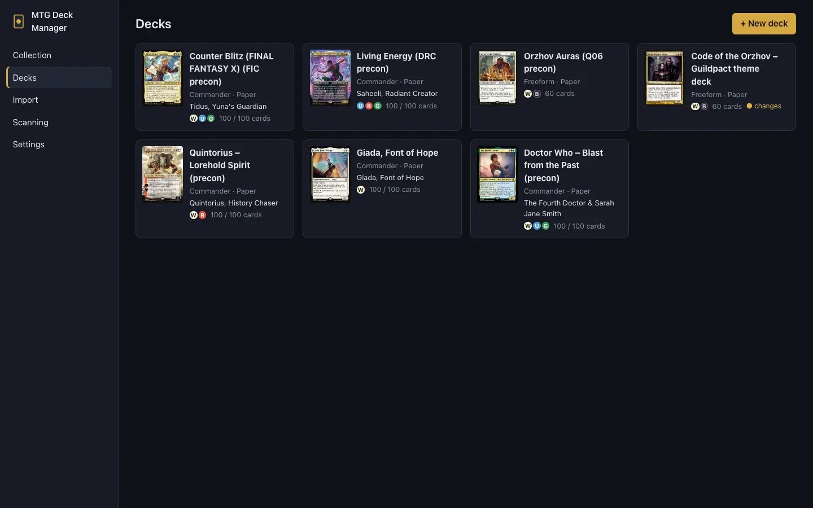
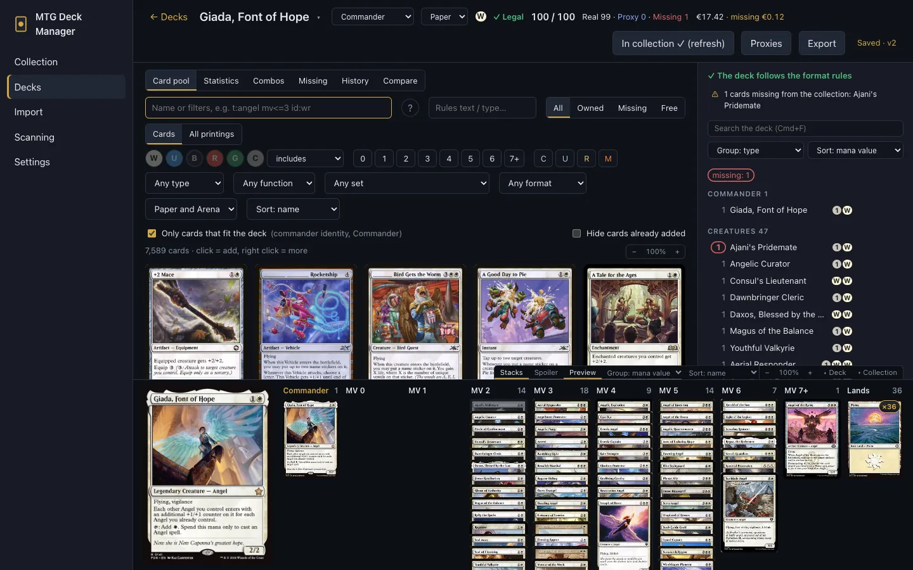
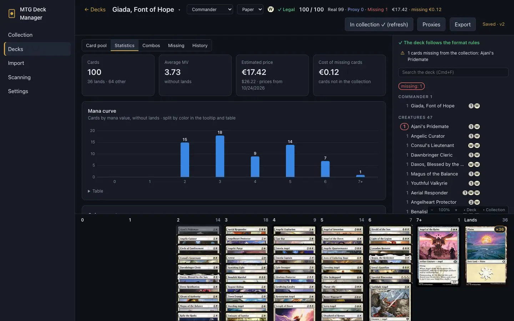
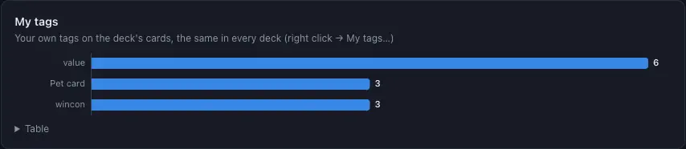
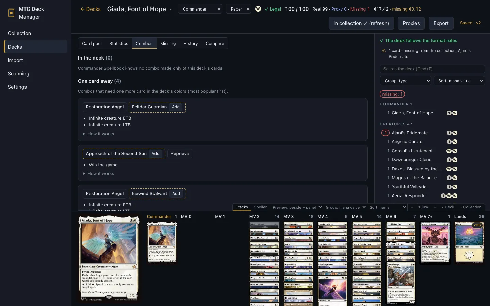
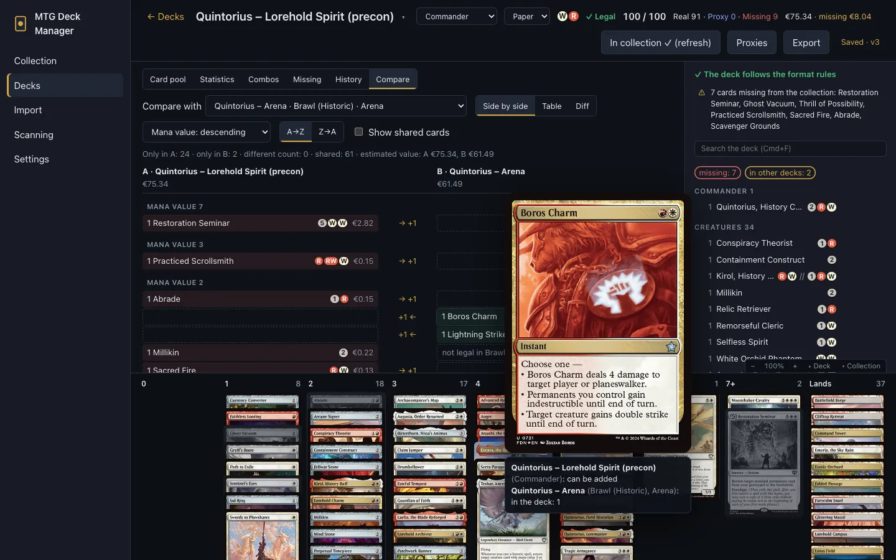
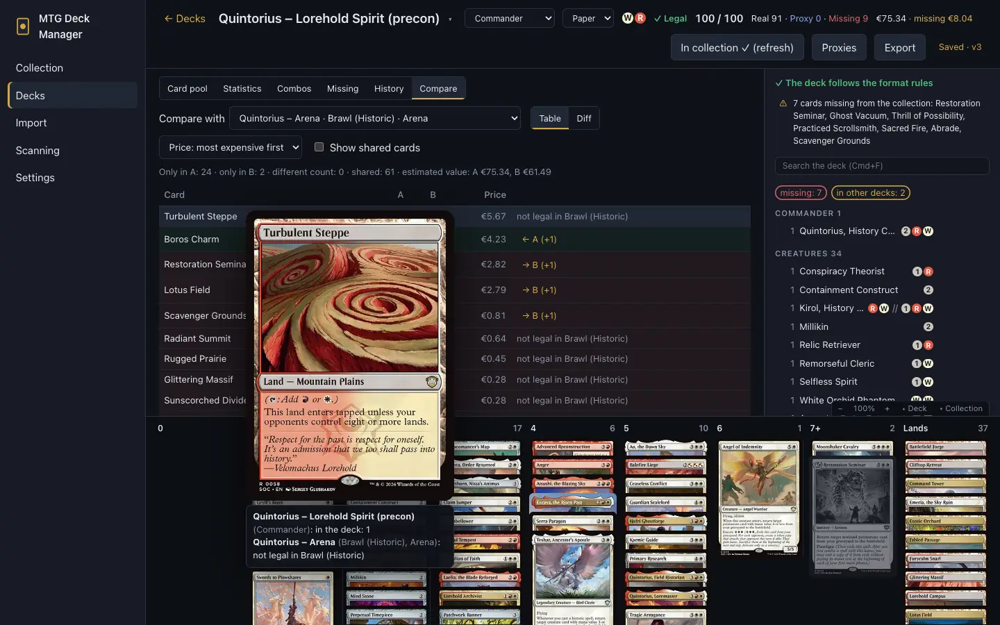
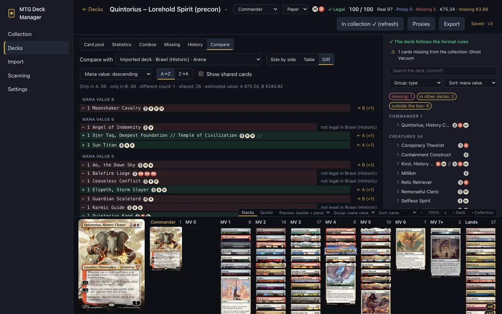

# Decks and the deckbuilder

[← Contents](index.md)

## The deck list

**Decks** shows every deck with its format, commander, colors and card count. **+ New deck**
creates an empty deck. Load a decklist or a precon in [Import](import-export.md).

## The deckbuilder

**The header:**
- the deck's name; ▾ next to it switches to another deck on the same tab;
- the format: Commander, Brawl, Standard Brawl, Historic, Standard, Pioneer, freeform;
- the platform: paper or Arena;
- colors, the validation result, the card count;
- in a paper deck: **Real · Proxy · Missing** (adding up to the deck's size) and the price of
  what's missing.

**Buttons:**
- **I own this deck:** moves the deck's cards into its box. It then reads "In collection ✓", and a
  click refreshes it;
- **Proxies:** [proxy printing](proxies.md);
- **Export:** [deck export](import-export.md#export).

**Tabs:** **Card pool**, **Statistics**, **Combos**, **Missing**, **History**, **Compare**.

### Card pool

The pool is a search with the same filters as the [Collection](collection.md#search):

- **Only cards that fit the deck:** the commander's color identity, format legality, Arena
  availability;
- **Hide cards already added;**
- a click adds a card to the deck, and right click gives more: maybeboard, sideboard, commander,
  [similar cards](collection.md#similar-cards), my tags, shopping list;
- cards can be dragged into the deck too.

Hovering a card shows how many copies the deck has, how many you own and where they are (e.g. in
another deck's box). Singleton duplicates are greyed out.

### The deck list and mana columns

On the right is the deck by section (commander, creatures, spells…). Find a card in it with
Cmd+F / Ctrl+F. At the bottom are columns by mana value.

In a paper deck, the color of a card's quantity tells where its copies are:
- **missing:** you don't own enough copies;
- **in another deck:** your copies sit in another deck's box (the tooltip names the deck);
- **not in box:** you own it, but it isn't in this deck's box.

Right-clicking a card in the deck moves it between the deck's parts (main, maybeboard, sideboard,
commander, companion) and gives it a **Category**: its role in this deck, e.g. "Ramp". Categories
count in the statistics.

### Validation

The format's rules are checked as you build: deck size, number of copies, the commander and its
color identity, card legality. The result shows in the header and above the deck list.

## Statistics

The **Statistics** tab shows:
- the mana curve, colors (costs and mana sources), types and rarity;
- **card functions** from Scryfall's tags (ramp, draw, removal, board wipes…), searchable with
  `otag:` too;
- **My tags** and **Categories**;
- the price of the deck and of its missing cards, and the wildcards an Arena deck needs.

## Combos

The **Combos** tab shows combos from [Commander Spellbook](https://commanderspellbook.com):

- **In the deck:** combos made only of the deck's cards;
- **One card away:** the missing card is one click from the deck.

**How it works** expands a combo's prerequisites and steps.

## Version history

Decks save as you edit. **Save version** takes a snapshot, and everything since the last snapshot is
highlighted: added cards in green, removed ones struck through in red, swapped printings in yellow.
You can compare versions, restore one or discard unsaved changes.

## Comparing decks

The **Compare** tab puts this deck (A) next to another one (B), e.g. the paper Quintorius and its
Arena version. Pick deck B from the list; the app suggests a deck with the same commander. Cards are
compared by name (any printing); the commander, main deck and companion count.

- **Side by side:** A on the left, B on the right, each card on one row with its mana cost and
  price; the deck without it shows an empty slot (or why the card doesn't fit there). Colors: what
  the other deck lacks, red on A's side, green on B's.
- **Table:** card, mana cost, copies in A and in B, price. Colors: only in A (red), only in B
  (green), different count (yellow).
- **Diff:** line under line, like comparing files: `− 2 Card` for A, `+ 1 Card` for B.
- **Sorting:** mana value ascending (the default) or descending, with a heading for each value;
  price, most expensive or cheapest first; name. Cards with the same mana value (or price) go by
  name, **A→Z** or **Z→A**.
- **Show shared cards** adds the cards both decks have alike.
- A summary above the list counts the cards only in A, only in B, with a different count and shared,
  with both decks' estimated value.

Hovering a card's name shows its preview and a short note for both decks: how many copies the deck
has, whether the card can be added, and if not, why (not legal in the format, outside the
commander's colors, not on Arena).

**→** and **←** (**→ B** and **← A** in the table and diff) add the missing copies to the other
deck, but only when the card can go there: legal in its format, within its commander's colors and,
for an Arena deck, on Arena. Singleton formats get one copy at most. An Arena deck gets Arena's
printing, a paper deck the printing you own the most copies of (or the default one).

## Missing

The **Missing** tab shows what a paper deck still needs and helps you buy it: see
[Missing cards and buying](buying.md).
