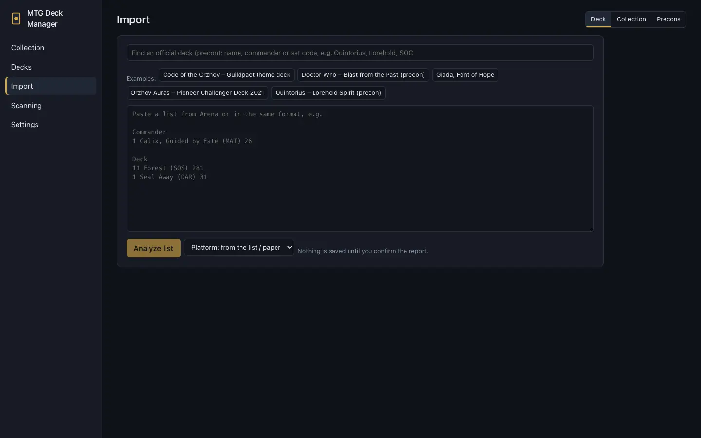

# Import and export

[← Contents](index.md)

**Import** has four tabs: **Deck**, **Collection**, **Precons** and **Boxes**.

## Importing a deck

1. Paste a list from MTG Arena or Moxfield (e.g. `4 Lightning Bolt (M10) 146`). Example lists are
   above the field.
2. **Analyze list** shows a match report: exact printings, warnings, suggestions for cards not
   found.
3. Once it looks right, save the deck. Nothing is saved before that.

## Precons

**Precons** lists the official Commander decks (from [MTGJSON](https://mtgjson.com), downloaded with
the card data), each with its colors, how many of its cards you own and the cards' value. You can
also load a precon in the **Deck** tab by searching for its name, commander or set code.

A deck's **Missing** tab suggests the precons that contain several of its missing cards.

## Boxes

**Boxes** are products with several small decks: a Beginner Box (e.g. Avatar: The Last Airbender –
ten 20-card decks), a Starter Kit (two decks), Jumpstart packs, Halfdecks. The lists come from
MTGJSON too, with exact printings.

1. Find a box by its name, set or a deck's name (the newest are shown before you type).
2. Each deck has a tile with its colors and card count; **Preview** shows its cards.
3. Tick decks and **Combine selected** – two 20-card halves make a 40-card deck. A single ticked deck
   becomes a deck of its own, and **The rest on their own** adds every deck not used yet. Each deck
   of the box can be used once.
4. In **Decks to create** you can rename them and preview the combined decks.
5. **I own this box** also adds the cards to the collection: each new deck goes into its own box
   (like "I own this deck"), and the unused decks can go to a location of your choice.
6. **Create decks** saves them all at once (freeform format).

In big pools (Jumpstart has over a hundred packs) a deck's cards are downloaded when you preview or
tick it, and a name filter sits above the tiles.

## Importing a collection

The **Collection** tab:
- **Card list:** a list in Arena format (e.g. the contents of a product that isn't a deck):
  `4 Name (SET) 123`. Sections and `#` comments are allowed, and `# preferred-sets: tle, tla` picks
  printings;
- **Moxfield CSV:** a file from Moxfield's collection export.

You get a report first; nothing is saved until you add the cards.

## Export

**A deck** (the **Export** button in the deckbuilder):
- **MTG Arena:** printings that aren't on Arena are swapped, and the app lists the swaps;
- **a text list** with printings;
- **PDF** with one card per page, to browse the deck on a phone.

**The collection** (the **Copies** tab):
- **Copy list (Arena format):** `4 Name (SET) 123`;
- **CSV;**
- **CSV for Moxfield:** in Moxfield, Collection → Import → Moxfield format. Conditions are converted
  to Moxfield's scale.

**Missing cards and the shopping list:** for Cardmarket, as CSV, and to CardTrader
([Missing cards and buying](buying.md)).

**Everything:** a JSON backup ([Settings](settings.md#backup)).
