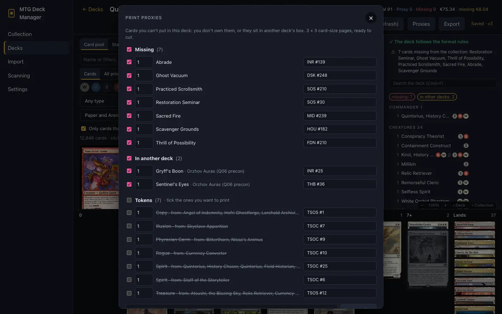
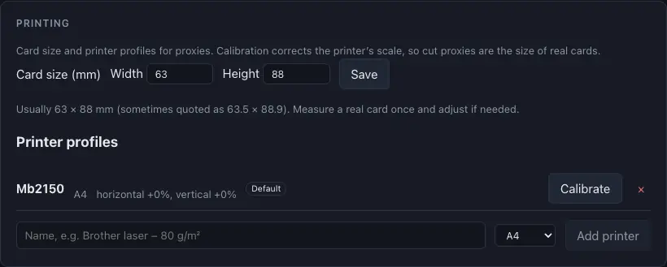

# Proxy printing

[← Contents](index.md)

Proxies are for personal playtesting only, not for sale.

## Proxies from a deck

In a paper deck, the **Proxies** button lists the cards you can't put in its box:
- **Missing:** you don't own them;
- **In another deck:** your copies sit in another deck's box (named);
- **Tokens** the deck makes;
- **Added by hand:** any other cards.

Pick quantities and printings, then set up the print:
- **paper** A4 or Letter, 3 × 3 cards per page, a **gap** and **crop marks**;
- **look:** card images from Scryfall (unaltered) or **text proxies** that save ink: name, cost,
  type, text, stats and price in a thin frame;
- **two-sided:** a double-faced card's other face goes on the back, and other cards get the app's
  card back;
- a **printer** profile from [calibration](#printer-calibration).

After printing, the app offers to record the printed cards as proxies in the deck's box.

## Proxies from the collection

Print any other cards or tokens from **Collection → Print proxies**. Add cards:
- by picking them in the grid (**Pick for printing**);
- with right click → **Add to proxy printing**;
- by searching in the dialog or pasting a list.

The tokens the added cards make are listed under **Tokens**, unticked: tick the ones you want to
print.

## Proxies in a deck

A proxy is part of a deck but never counts as a card you own:
- the deckbuilder marks proxied cards with a PROXY chip, and the header shows
  `Real · Proxy · Missing`;
- the **Missing** tab lists them apart, as "covered by proxy – to buy";
- **Collection → Proxies** lists every proxy with its deck and whether you own the real card by now.
  Replace it with the real card after buying one (or move in a loose copy you have), move it,
  remove it or print it again.

## Printer calibration

Printers scale and shift pages slightly. **Settings → Printing**:
- **Card size (mm):** usually 63 × 88; measure a real card and adjust if needed;
- **printer profiles:** print a calibration page and measure two lengths with a ruler. Later prints
  come out at real card size, so cut proxies fit sleeves;
- for two-sided prints, a test page shows how far the printer puts the back off the front (read
  against the light on a 0.5 mm scale), and backs are moved to match.

Print at 100% ("Actual size"), without "Fit to page".
