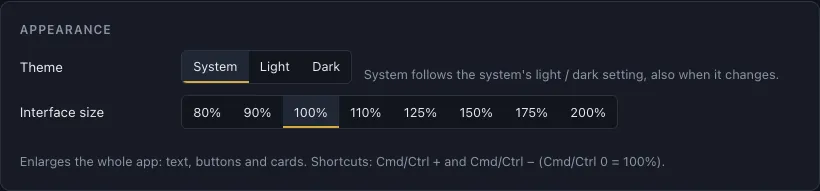
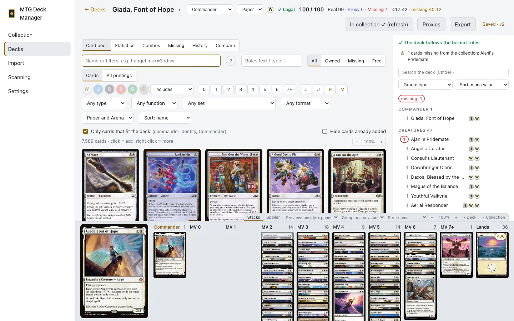

# Settings and backups

[← Contents](index.md)

## Language

**Language:** English or Polish. Changing it reloads the app.

## Appearance

**Theme:** **System** (the default) follows the system's light / dark setting, also when it changes
while the app is open; **Light** and **Dark** fix the theme.

**Interface size** enlarges the whole app: text, buttons and cards, e.g. on a big screen. Pick 80% to 200% or use
**Cmd/Ctrl +** and **Cmd/Ctrl −** (**Cmd/Ctrl 0** goes back to 100%). The app remembers the size,
like the other view settings (deckbuilder layout, grouping, card size). In a browser
(`mtgdm serve`) the browser's own zoom does this instead.

## Card data (Scryfall)

- **Download card data / Refresh data:** downloads the cards from Scryfall (about 80 MB), card
  functions (Scryfall's tags) and precon lists. Refresh once a week or after a set release.
- **Check for updates:** checks whether Scryfall has newer data.
- **Force full import:** imports the cards again even when the data hasn't changed.

Scryfall's prices are up to a day old, so the app shows them as estimates.

## Backup

- **Save backup:** your collection, locations, decks (with their version history), shopping list,
  your tags and printer profiles as one JSON file. Scryfall's card data isn't in it (it can be
  downloaded again), and neither is the CardTrader token.
- **Load backup…:** restores a backup, adding it to what's there. With **replace the current data
  (instead of adding)** checked, the current data is removed first. A broken file changes nothing.

### Automatic cloud backup

In **Backup**, choose a folder that iCloud Drive, OneDrive or Dropbox syncs (the app suggests the
ones it finds). After every change the app writes `mtgdm-backup.json` there, with older copies in
`history/`.

On another computer using the same folder, the app offers to load newer data written there (its own
data goes to `history/` first) or to keep its own. It never overwrites anything without asking.

## Printing

Card size and printer profiles for proxies: see
[printer calibration](proxies.md#printer-calibration).

## CardTrader

Your API token and the language of the cards on the wishlist: see [CardTrader](buying.md#cardtrader).

## Application

The data folder, database size, app version, and the check for new versions, which you can turn off
here.
