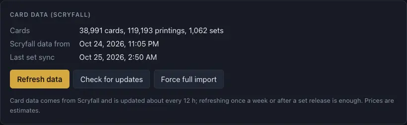

# Getting started

[← Contents](index.md)

## Installing

Download the latest version from [Releases](https://github.com/wjaros/mtg-manager/releases):

- **macOS:** `…-arm64.dmg` for Apple Silicon (M1–M4) or `…-x86_64.dmg` for Intel. Open the DMG and
  drag the app to Applications. The app isn't notarized by Apple: the first time, open it with
  right click → **Open**.
- **Windows:** `…-windows-x64.zip`. Unpack it and run `MTG Deck Manager.exe`. The app's window uses
  Microsoft Edge WebView2, built into Windows 11 and current Windows 10. The app isn't signed, so
  Windows may show **Windows protected your PC**: click **More info → Run anyway**. It asks again
  for every new version; to skip it, right-click the ZIP before unpacking → **Properties** and tick
  **Unblock**.

## First start: card data

The app needs Scryfall's card data (about 80 MB to download; the import takes 2–3 minutes):

1. Open **Settings** (menu on the left).
2. In **Card data (Scryfall)**, click **Download card data**.
3. Wait for the progress bar to finish. Card functions (Scryfall's tags: ramp, removal, draw…) and
   precon lists come with the cards.

Refresh the data now and then (**Refresh data**). The app suggests it when Scryfall has newer data;
once a week or after a set release is plenty. Scryfall's prices are up to a day old, so the app
shows them as estimates, with their date.

## The app's parts

The menu on the left leads to five parts:

- **[Collection](collection.md):** every card, your copies, locations, proxies and the shopping
  list.
- **[Decks](decks.md):** the deck list and the deckbuilder.
- **[Import](import-export.md):** decklists, precons and collections.
- **[Scanning](scanning.md):** cards from photos and scans into the collection.
- **[Settings](settings.md):** card data, language, backups, printing, CardTrader.

**Collapse menu** at the bottom of the menu leaves only the icons (the name shows on hover) to make
more room; the arrow expands it again. The app remembers the choice.

## Language

The interface is in English and Polish: **Settings → Language**. Changing it reloads the app.

## App updates

On start the app checks GitHub (at most every few hours) for a new version. When there is one, it
shows what's new and a download button for your system. **Skip this version** stops the reminders
until the next release. The check can be turned off in **Settings → Application**. There's no
automatic install: download the new version and replace the old one. Your data stays, as it lives
in a separate folder.

## Where your data is

- macOS: `~/Library/Application Support/MTGDeckManager/`
- Windows: `%APPDATA%\MTGDeckManager\`

The folder holds the database, card images, scans and the log. For backups, see
[Settings](settings.md#backup).
