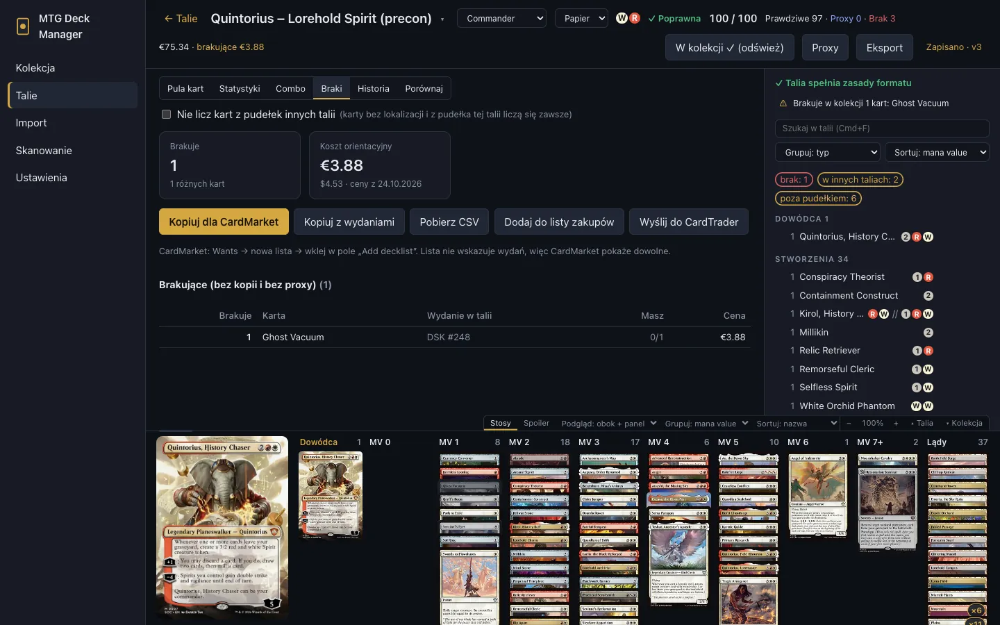
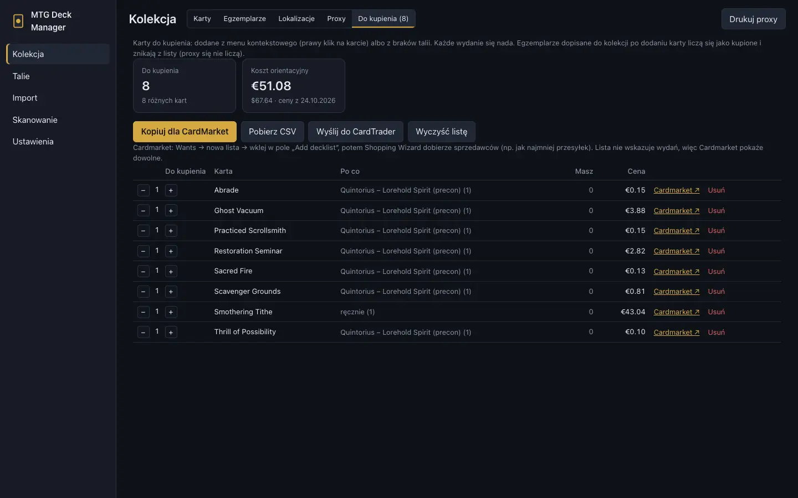
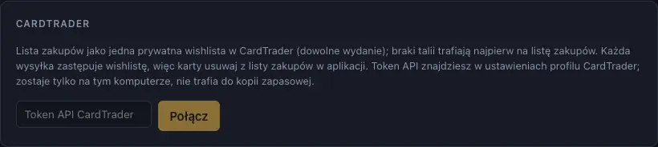

# Braki i zakupy

[← Spis treści](index.md)

## Braki talii

Zakładka **Braki** w deckbuilderze (talia papierowa) pokazuje karty, których brakuje, z ceną
orientacyjną:

- **Nie licz kart z pudełek innych talii:** karty wbudowane w inne talie liczą się jako
  niedostępne, więc lista pokazuje, co kupić, żeby mieć obie talie naraz;
- karty, za które w pudełku stoi proxy, są osobno („pokryte przez proxy – do kupienia”);
- na dole są precony, które zawierają kilka brakujących kart.

Przyciski:
- **Kopiuj dla CardMarket:** lista „1 Nazwa” do wklejenia na Cardmarket;
- **Kopiuj z wydaniami:** lista z setem i numerem karty;
- **Pobierz CSV;**
- **Dodaj do listy zakupów** (opis niżej);
- **Wyślij do CardTrader** ([CardTrader](#cardtrader)).

### Cardmarket

1. Kliknij **Kopiuj dla CardMarket**.
2. Na Cardmarket: **Wants** → nowa lista → wklej w **Add decklist**.
3. **Shopping Wizard** Cardmarketu dobierze sprzedawców, np. z najmniejszą liczbą przesyłek.

Lista nie podaje wydań, więc Cardmarket pokaże każde.

## Lista zakupów

**Kolekcja → Do kupienia** zbiera karty do kupienia ze wszystkich talii. Trafiają na nią:
- braki talii (**Dodaj do listy zakupów** w zakładce **Braki**). Ponowne dodanie zastępuje to, co
  ta talia dodała wcześniej;
- dowolna karta z menu prawego przycisku (**Dodaj do listy zakupów**).

Liczy się karta, a nie wydanie. Lista pokazuje, dla których talii jest karta, ile kopii już masz i
cenę orientacyjną. Prawdziwe egzemplarze dodane do kolekcji później liczą się jako kupione i
znikają z listy (proxy się nie liczą). Pozycje zmniejszysz albo usuniesz ręcznie. Listę skopiujesz
dla Cardmarketu, pobierzesz jako CSV albo wyślesz do CardTradera.

## Zakupy w sklepach

Linki do wyszukiwania karty w sklepach i planer koszyka. Allegro nie daje dostępu przez API do
ofert innych sprzedawców ani do koszyka, więc aplikacja **tylko otwiera wyszukiwanie w
przeglądarce**: niczego nie pobiera z Allegro ani ze sklepów sprzedawców.

### Sklepy (Ustawienia → Gdzie kupić)

Każdy sklep to adres wyszukiwania z `{query}` w miejscu szukanej frazy. Na start jest **Allegro**
(`https://allegro.pl/listing?string={query}`, dopisek „ mtg”); można go zmienić albo wyłączyć.

Ulubionego sprzedawcę dodasz tak:
1. Wyszukaj coś w jego sklepie na Allegro albo w jego sklepie internetowym.
2. Skopiuj adres strony z wynikami.
3. **Dodaj sklep**, wklej adres i zamień szukaną frazę na `{query}`.
4. **Test** otwiera wyszukiwanie „Sol Ring”.

Opcje sklepu:
- **Szukaj:** samej nazwy karty albo nazwy karty z nazwą setu;
- **Dopisek do frazy:** np. „ mtg” (ze spacją na początku);
- **Darmowa dostawa od** i **Wysyłka poniżej progu:** gdy sprzedawca ma własne zasady (puste =
  ustawienia ogólne). Sklep o tej samej nazwie co sprzedawca w ofercie ustala jego próg.

Karta dwustronna jest szukana po nazwie przedniej strony („Delver of Secrets”).

### Gdzie są linki

- **Kup ▾** przy karcie w zakładce **Braki**, w **Kolekcja → Do kupienia**, w **Kolekcja → Proxy**
  (proxy kart, których jeszcze nie masz) i w panelu szczegółów karty: jeden link na włączony sklep.
- Zakładka **Zakupy** w deckbuilderze (albo **Lista zakupów** w zakładce **Braki**).

### Zakładka Zakupy

Tabela kart do kupienia talii: brakujące i te, za które stoi proxy (powód: brak / proxy), z
liczbą sztuk i kolumną linków na każdy sklep.

- **Kupione:** odhacz kartę kupioną lub zamówioną. Stan jest zapamiętany dla talii, więc listę
  można przerabiać przez kilka dni. **Odznacz wszystko** zaczyna od nowa.
- **Otwórz zaznaczone:** otwiera wyszukiwania zaznaczonych kart w wybranym sklepie. Aplikacja
  okienkowa otwiera je w przeglądarce systemowej, karta po karcie. W przeglądarce otworzy się
  pierwsza, a resztę pokazuje lista linków (przeglądarka blokuje wiele okien na jedno kliknięcie).
  Przy więcej niż 10 kartach aplikacja pyta o zgodę.
- **Kopiuj dla CardMarket:** porównaj ceny całej listy na CardMarket (filtr sprzedawców wg kraju:
  Polska).

### Planer koszyka

Allegro Smart! daje darmową dostawę od kwoty zamówienia **u jednego sprzedawcy** (49,90 zł od 2
marca 2026; próg się zmienia, ustawisz go w **Ustawienia → Gdzie kupić**). Przy kartach po 1–5 zł
opłaca się skupić zakupy u 1–2 sprzedawców, nawet jeśli pojedyncze karty są tam trochę droższe.

1. **+ oferta** przy karcie: sprzedawca (podpowiedzi z wcześniejszych), cena za sztukę, opcjonalnie
   dostępna liczba sztuk i link do oferty. **Enter** zapisuje i przechodzi do następnej karty
   z tym samym sprzedawcą.
2. Pierwsza oferta karty jest od razu wybrana; inną wybierasz kółkiem. **Najtańsza** /
   **Najtańsze dla wszystkich** wybierają najtańsze oferty.
3. **Koszyk wg sprzedawców:** każdy sprzedawca z wybranymi kartami, sumą i paskiem postępu do
   darmowej dostawy. Gdy brakuje do progu, aplikacja podpowiada karty, które ten sprzedawca też
   ma (z różnicą ceny), a **dodaj** przenosi wybór.
4. Podsumowanie: karty + szacowana wysyłka (0 powyżej progu) i liczba paczek. **Otwórz oferty**
   otwiera linki ofert sprzedawcy, **Kopiuj listę** kopiuje „1 Karta – cena”.
5. **Zaproponuj koszyk** dobiera jedną ofertę na kartę tak, by karty + wysyłka kosztowały jak
   najmniej. Propozycję przyjmujesz albo odrzucasz; bez przyjęcia nic się nie zmienia.

Karty odhaczone jako kupione nie wchodzą do koszyka. Oferty i wybory są zapisane dla talii (także w
kopii zapasowej).

### Porównanie z CardTrader Zero

Z tokenem CardTradera ([CardTrader](#cardtrader)) **Pobierz oferty CardTrader** szuka dla każdej
karty najtańszych ofert sprzedawców wysyłających przez CardTrader Zero (jedna paczka, jedna
opłata; domyślnie 18 USD). Ceny są przeliczane po kursach wpisanych ręcznie w ustawieniach.

Porównanie pokazuje trzy warianty: wybrane oferty sprzedawców, wszystko z CardTrader Zero i
**mieszany** (tańsze karty do CardTradera, o ile żaden sprzedawca nie spadnie poniżej progu
darmowej dostawy). Karty, których nie ma w CardTrader Zero, są wypisane osobno. **Wyślij do koszyka
CardTrader** dodaje oferty kart z wariantu mieszanego do koszyka na CardTraderze; zakup robisz sam
na stronie.

## CardTrader

Lista zakupów może być jedną prywatną wishlistą w [CardTrader](https://www.cardtrader.com),
aktualizowaną jednym kliknięciem.

### Połączenie (raz)

1. Na stronie CardTrader otwórz ustawienia swojego profilu i skopiuj **token API**.
2. W aplikacji: **Ustawienia → CardTrader**, wklej token i kliknij **Połącz**. Aplikacja sprawdzi
   token w CardTraderze.
3. Opcjonalnie wybierz **Język kart na wishliście** (domyślnie dowolny).

Token zostaje tylko na tym komputerze: nie trafia do kopii zapasowej ani do folderu kopii w
chmurze. **Odłącz** go usuwa. Jeśli token wycieknie, wygeneruj w CardTraderze nowy.

### Wysyłanie

- Na liście zakupów kliknij **Wyślij do CardTrader**: wishlista „MTG Deck Manager – do kupienia”
  dostaje całą listę zakupów (dowolne wydanie).
- W zakładce **Braki** ten sam przycisk najpierw dopisuje braki talii do listy zakupów, a potem
  aktualizuje wishlistę.

API CardTradera nie pozwala edytować wishlisty, więc każda wysyłka tworzy nową i usuwa poprzednią.
**Zmiany zrobione na CardTraderze zostaną nadpisane**: kart, których nie chcesz kupować (np. za
drogich), usuwaj z listy zakupów w aplikacji. Pusta lista zakupów usuwa wishlistę.

CardTrader po cichu pomija karty, których nie rozpozna. Aplikacja sprawdza wishlistę po wysłaniu i
wypisuje takie karty, żebyś mógł je dodać ręcznie. Jeśli wybrany język nie zostanie zapisany,
aplikacja też to zgłosi.
