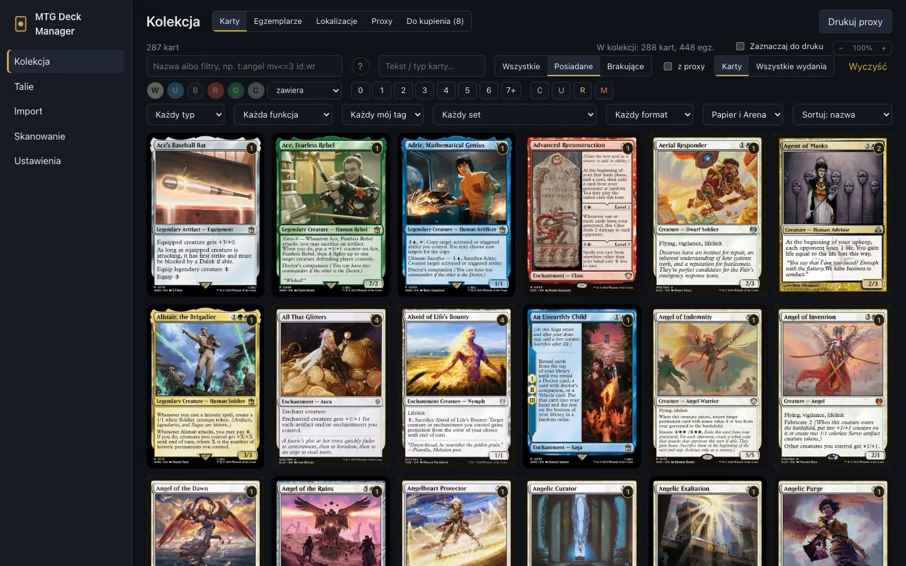
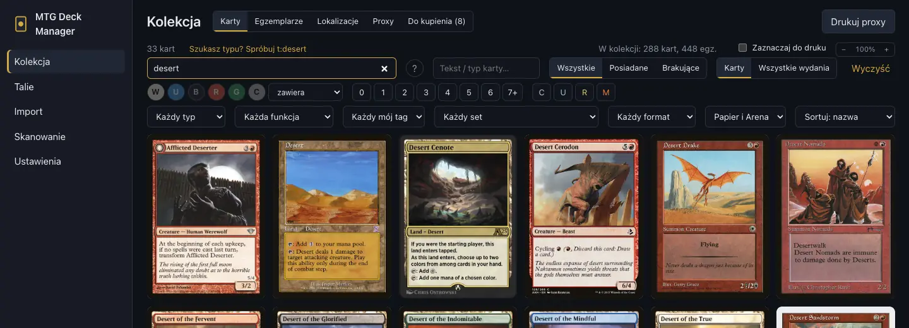
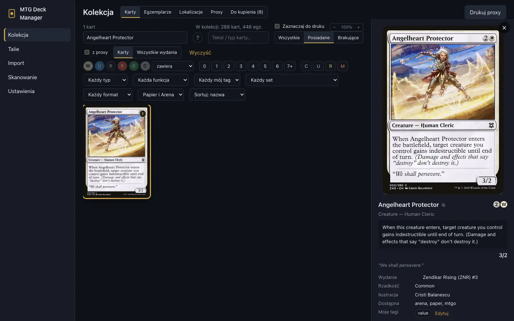
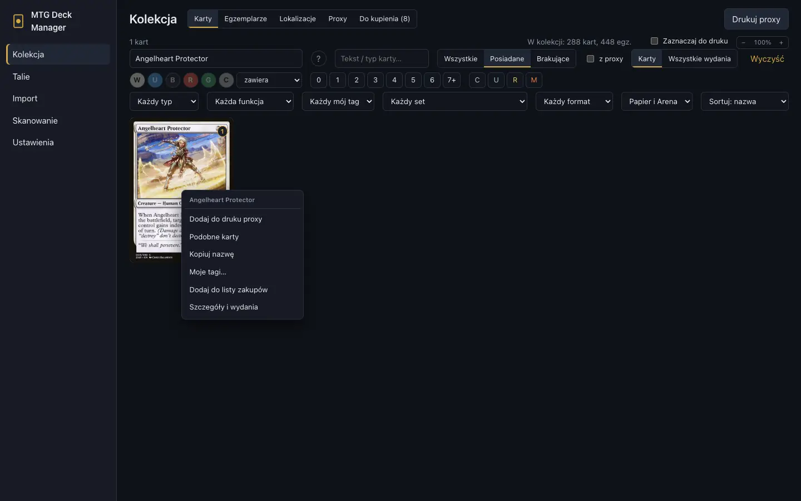
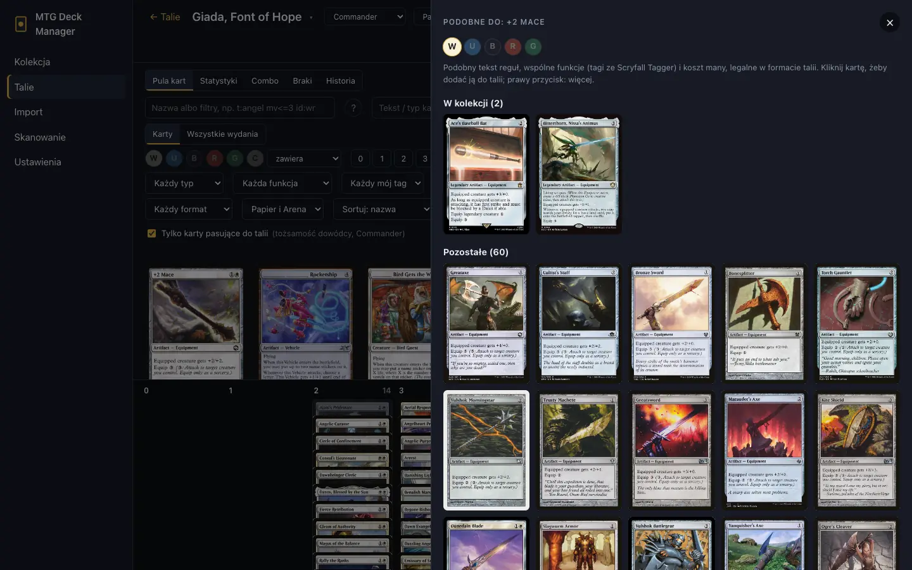
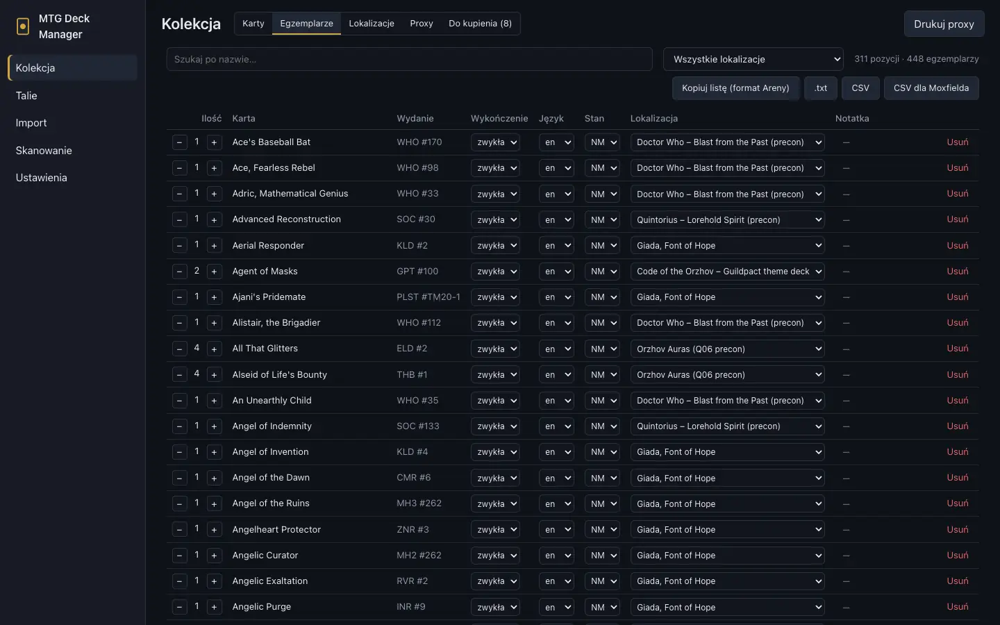
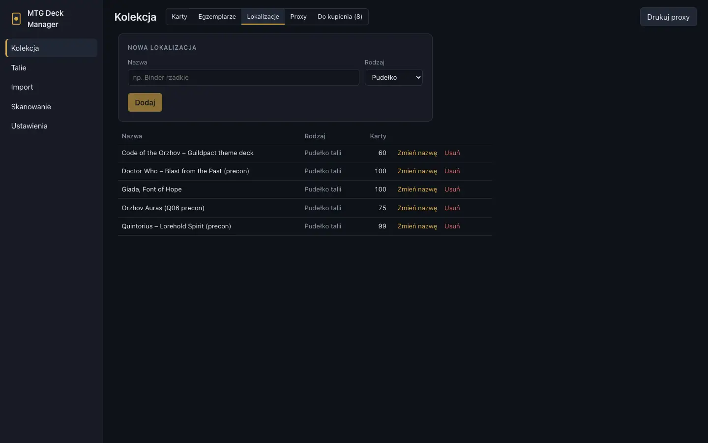

# Kolekcja

[← Spis treści](index.md)

**Kolekcja** ma pięć zakładek: **Karty** (wszystkie karty ze Scryfalla), **Egzemplarze** (twoje
fizyczne karty), **Lokalizacje**, **Proxy** i **Do kupienia**.

## Wyszukiwanie

- **Nazwa albo filtry** (pierwsze pole): słowa z nazwy karty albo filtry w składni Scryfalla, np.
  `t:angel mv<=3 id:wr`. Przycisk **?** obok pokazuje całą składnię.
- **Tekst / typ karty**: słowa z tekstu reguł albo linii typu.
- Filtry pod spodem: kolory (z trybem: zawiera / dokładnie / w tożsamości), koszt many, rzadkość,
  typ, funkcja karty, mój tag, set, format, gra (papier / Arena).
- **Wszystkie / Posiadane / Brakujące**: wszystkie karty, tylko twoje albo tylko te, których nie
  masz.
- **Karty / Wszystkie wydania**: jedna pozycja na kartę albo każde wydanie osobno.
- Sortowanie i powiększenie siatki są w prawym rogu.

Najczęstsze elementy składni:

| Składnia | Znaczenie |
|---|---|
| `t:angel`, `t:creature` | typ albo podtyp w linii typu |
| `o:"enters the battlefield"` | tekst reguł |
| `c:wu`, `c=r`, `c:m` | kolory: co najmniej / dokładnie / wielokolorowe |
| `id:wr`, `id<=wr` | tożsamość kolorów mieści się w podanych kolorach |
| `mv>=5`, `mv=2` | koszt many |
| `r:mythic`, `r>=rare` | rzadkość |
| `s:who` | set (kod Scryfalla) |
| `f:commander` | legalne w formacie |
| `otag:removal` | funkcja karty (tag Scryfalla) |
| `tag:wincon` | twój własny tag |
| `-t:creature` | minus przed filtrem go odwraca |

Słowa bez klucza szukają w **nazwach** kart, tak jak na Scryfallu. Gdy wpiszesz słowo, które jest
typem karty (np. „desert”), aplikacja podpowie zapytanie z filtrem typu. Kliknięcie je zastosuje.

## Twoje wydanie karty

Jeśli masz kartę, siatka pokazuje wydanie, którego masz najwięcej kopii (przy remisie to dodane
ostatnio), a nie domyślne. Dotyczy to też puli kart w deckbuilderze talii papierowych. Przy
filtrach wydania (set, rzadkość) i w wyszukiwaniu kart z Areny widać wydanie pasujące do filtra.

## Szczegóły karty

Kliknij kartę, a z prawej otworzy się panel szczegółów:

- obraz i tekst karty, wydanie, rzadkość, ilustrator, cena orientacyjna z datą;
- **twoje egzemplarze i gdzie leżą**, np. „1× DOM #31 · NM · Giada, Font of Hope” oznacza, że
  karta jest w pudełku tej talii;
- **Moje tagi** z przyciskiem **Edytuj**;
- wszystkie wydania karty;
- przycisk ⧉ przy nazwie kopiuje nazwę karty do schowka.

## Menu karty (prawy przycisk)

Prawy przycisk na karcie otwiera menu:

- **Dodaj do druku proxy** ([drukowanie proxy](proxies.md));
- **Podobne karty** (opis niżej);
- **Kopiuj nazwę**;
- **Moje tagi…**;
- **Dodaj do listy zakupów** ([lista zakupów](buying.md));
- **Szczegóły i wydania**.

## Podobne karty

**Podobne karty** szukają kart, które robią to samo co wybrana karta. Liczą się:

- podobny tekst reguł;
- wspólne funkcje z tagów Scryfall Tagger;
- koszt many.

Karty, które już masz, są na górze w sekcji **W kolekcji**, a pod nimi **Pozostałe**. Domyślnie
widać tylko karty w kolorach wybranej karty; przełączniki W U B R G dodają kolejne kolory.

W deckbuilderze lista bierze pod uwagę format talii i pomija karty, które już w niej są. Kliknięcie
dodaje kartę do talii. Przycisk **Kolory talii** zaznacza kolory dowódcy. W
[porównaniu talii](decks.md) (zakładka **Porównaj**) wybierasz, do której z dwóch talii szukać.

## Moje tagi

Własne tagi na kartach („wincon”, „pet card”, „do cube'a”…):

1. Prawy przycisk na karcie → **Moje tagi…** (albo **Edytuj** w szczegółach karty).
2. Wpisz tagi po przecinku. W okienku widać tagi, których już używasz.
3. Szukaj ich przez `tag:wincon` (albo `tag:"pet card"`) lub listę **Każdy mój tag** w filtrach.

Tag należy do karty, więc mają go wszystkie jej wydania, w kolekcji i w każdej talii. Wielkość
liter nie ma znaczenia: wpisane „WINCON” przejmie istniejące „wincon”. Statystyki talii liczą
karty z każdym tagiem ([statystyki](decks.md#statystyki)). Tagi są w kopii zapasowej.

## Egzemplarze

**Egzemplarze** to twoje fizyczne karty: wydanie, wykończenie (foil itp.), język, stan, lokalizacja
i notatka. Egzemplarze dodasz [skanowaniem](scanning.md), [importem](import-export.md) albo
ręcznie. Ilość, stan i lokalizację zmienisz bezpośrednio w tabeli.

Nad tabelą są eksporty: **Kopiuj listę (format Areny)**, **CSV** i **CSV dla Moxfielda**
(szczegóły w [eksporcie](import-export.md#eksport)).

## Lokalizacje

Lokalizacje to miejsca, gdzie leżą karty: segregatory, pudełka i pudełka talii. Talia papierowa
ma swoje pudełko (**Mam tę talię** w deckbuilderze przenosi tam jej karty), dzięki czemu aplikacja
wie, czy karta leży w talii, czy luzem, czy w pudełku innej talii.

