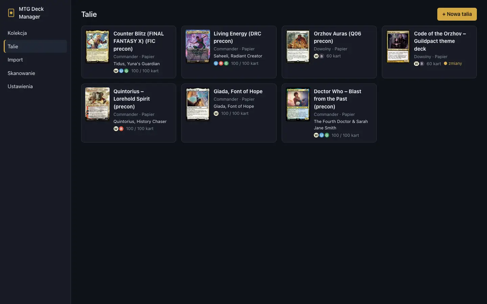
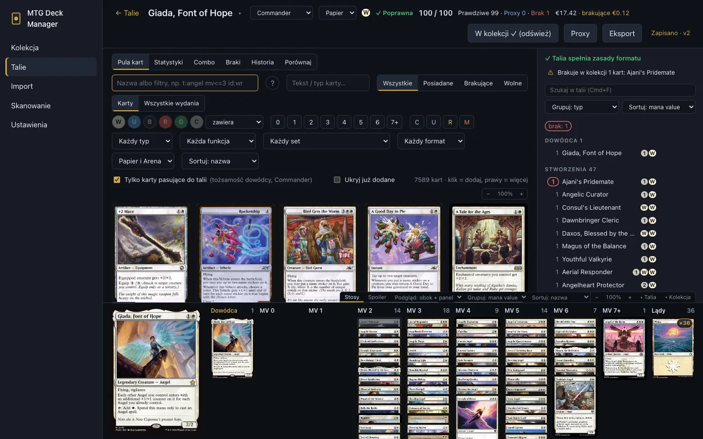
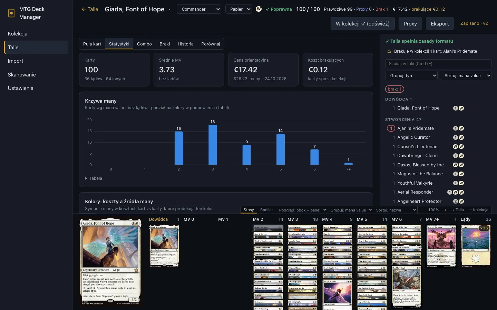
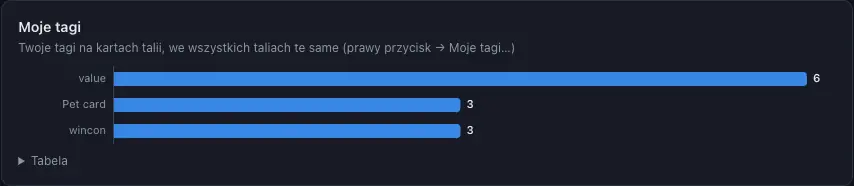
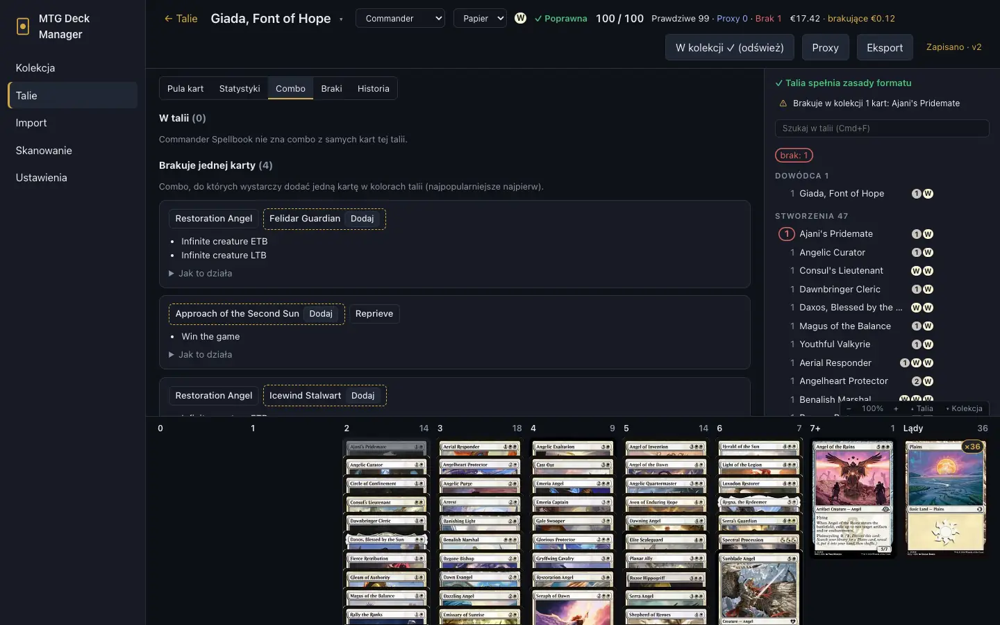
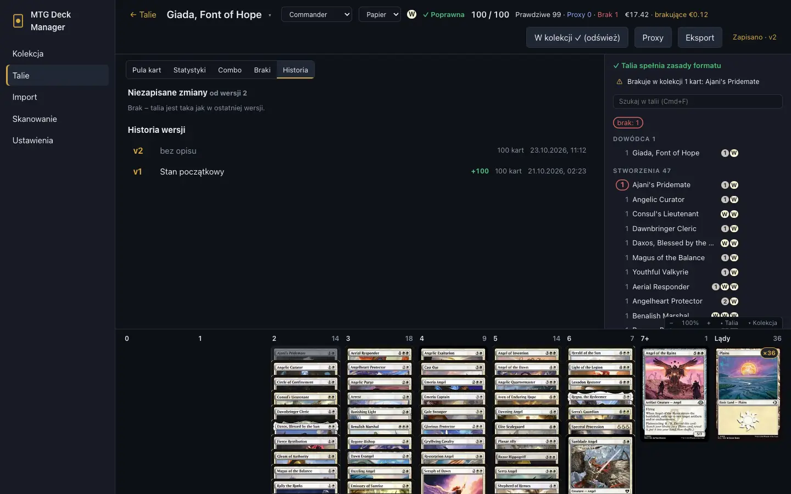

# Talie i deckbuilder

[← Spis treści](index.md)

## Lista talii

**Talie** pokazują wszystkie talie z formatem, dowódcą, kolorami i liczbą kart. **+ Nowa talia**
tworzy pustą talię. Gotową listę albo precon wczytasz w [Imporcie](import-export.md).

## Deckbuilder

**Nagłówek:**
- nazwa talii; ▾ obok niej przełącza na inną talię, na tej samej zakładce;
- format: Commander, Brawl, Standard Brawl, Historic, Standard, Pioneer, freeform;
- platforma: papier albo Arena;
- kolory, wynik walidacji, liczba kart;
- w talii papierowej: **Prawdziwe · Proxy · Brak** (sumuje się do rozmiaru talii) i cena tego,
  czego brakuje.

**Przyciski:**
- **Mam tę talię:** przenosi karty talii do jej pudełka. Potem widać „W kolekcji ✓”, a kliknięcie
  odświeża stan;
- **Proxy:** [drukowanie proxy](proxies.md);
- **Eksport:** [eksport talii](import-export.md#eksport).

**Zakładki:** **Pula kart**, **Statystyki**, **Combo**, **Braki**, **Historia**.

### Pula kart

Pula to wyszukiwarka z tymi samymi filtrami co [Kolekcja](collection.md#wyszukiwanie):

- **Tylko karty pasujące do talii:** tożsamość kolorów dowódcy, legalność w formacie, dostępność na
  Arenie;
- **Ukryj już dodane;**
- klik dodaje kartę do talii, a prawy przycisk otwiera więcej opcji: maybeboard, sideboard,
  dowódca, [podobne karty](collection.md#podobne-karty), moje tagi, lista zakupów;
- karty można też przeciągać do talii.

Po najechaniu na kartę widać, ile kopii jest w talii, ile masz w kolekcji i gdzie leżą (np. w
pudełku innej talii). Duplikaty w formatach singleton są przygaszone.

### Lista talii i kolumny many

Z prawej jest lista talii w sekcjach (dowódca, stworzenia, czary…). Wyszukasz w niej kartę przez
Cmd+F / Ctrl+F. Na dole są kolumny według kosztu many.

W talii papierowej kolor liczby przy karcie mówi, gdzie są jej egzemplarze:
- **brak:** nie masz wystarczająco kopii;
- **w innej talii:** twoje kopie leżą w pudełku innej talii (podpowiedź podaje której);
- **nie w pudełku:** masz kartę, ale nie leży w pudełku tej talii.

Prawy przycisk na karcie w talii przenosi ją między częściami talii (główna, maybeboard, sideboard,
dowódca, companion) i nadaje jej **Kategorię**: rolę w tej talii, np. „Rampa”. Kategorie liczą się
w statystykach.

### Walidacja

Reguły formatu sprawdzane są na bieżąco: rozmiar talii, liczba kopii, dowódca i jego tożsamość
kolorów, legalność kart. Wynik widać w nagłówku i nad listą talii.

## Statystyki

Zakładka **Statystyki** pokazuje:
- krzywą many, kolory (koszty i źródła many), typy i rzadkość;
- **funkcje kart** według tagów Scryfalla (ramp, draw, removal, board wipe…), które wyszukasz też
  przez `otag:`;
- **Moje tagi** i **Kategorie**;
- cenę talii i brakujących kart, a w talii z Areny potrzebne wildcardy.

## Combo

Zakładka **Combo** pokazuje combo z [Commander Spellbook](https://commanderspellbook.com):

- **W talii:** combo z samych kart talii;
- **Brakuje jednej karty:** brakującą kartę dodasz jednym kliknięciem.

**Jak to działa** rozwija wymagania i kroki combo.

## Historia wersji

Talia zapisuje się na bieżąco. **Zapisz wersję** robi migawkę, a wszystko od ostatniej migawki jest
podświetlone: dodane karty na zielono, usunięte przekreślone na czerwono, zmienione wydania na
żółto. Wersje można porównywać i przywracać, a niezapisane zmiany odrzucić.

## Braki

Zakładka **Braki** pokazuje, czego brakuje do talii papierowej, i pozwala to kupić: opis w
[Braki i zakupy](buying.md).
