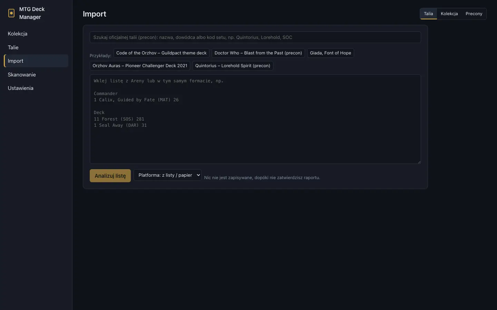

# Import i eksport

[← Spis treści](index.md)

**Import** ma cztery zakładki: **Talia**, **Kolekcja**, **Precony** i **Pudełka**.

## Import talii

1. Wklej listę z MTG Arena albo Moxfielda (np. `4 Lightning Bolt (M10) 146`). Przykładowe listy są
   nad polem.
2. **Analizuj listę** pokazuje raport dopasowania: dokładne wydania, ostrzeżenia, podpowiedzi przy
   nieznalezionych kartach.
3. Po sprawdzeniu zapisz talię. Nic nie zapisuje się przed tym krokiem.

## Precony

**Precony** to lista oficjalnych talii Commander (z [MTGJSON](https://mtgjson.com), pobierana razem
z danymi kart). Przy każdej widać kolory, ile kart z niej masz i wartość kart. Precon wczytasz też
w zakładce **Talia**, wyszukując go po nazwie, dowódcy albo kodzie setu.

W zakładce **Braki** talii aplikacja podpowiada precony, które zawierają kilka brakujących kart.

## Pudełka

**Pudełka** to produkty z kilkoma małymi taliami: Beginner Box (np. Avatar: The Last Airbender –
dziesięć talii po 20 kart), Starter Kit (dwie talie), pakiety Jumpstart, Halfdecki. Listy też
pochodzą z MTGJSON, z dokładnymi wydaniami kart.

1. Lista pudełek działa jak lista preconów: przy każdym widać kolory kart, ile z nich masz i wartość
   kart (suma cen pojedynczych kart, nie cena produktu); możesz filtrować po kolorach i sortować.
   Talie małych pudełek pobierają się z aktualizacją danych kart; duże pule Jumpstart pokazują
   liczby dopiero po pobraniu wszystkich pakietów. **W Taliach** prowadzi do już zaimportowanego
   pudełka. Szukasz po nazwie, secie albo nazwie talii (drobna literówka nie przeszkadza). Pudełka
   pokazuje też wyszukiwarka w zakładce **Talia** – kliknięte otwiera się tutaj.
2. Każda talia ma kafelek z kolorami i liczbą kart; pod kafelkami są wszystkie karty pudełka jak
   lista talii (ceny, wartość, czego brakuje, grupowanie po taliach albo typie), a **Podgląd**
   zawęża ją do jednej talii. Zaznaczone talie
   trafią do pudełka – w Beginner Boxie domyślnie wszystkie, w pulach Jumpstart zaznacz pakiety,
   które masz (karty pobierają się przy podglądzie albo zaznaczeniu, nad kafelkami jest filtr).
3. **Mam to pudełko** (domyślnie włączone) dodaje karty do kolekcji, do lokalizacji pudełka.
4. **Importuj pudełko** tworzy w [Taliach](decks.md) pudełko z tymi taliami. Łączenie ich w
   większe talie odbywa się tam, kiedy chcesz.

## Import kolekcji

Zakładka **Kolekcja**:
- **Lista kart:** lista w formacie Areny (np. zawartość produktu, który nie jest talią):
  `4 Nazwa (SET) 123`. Sekcje i komentarze `#` są dozwolone, a `# preferred-sets: tle, tla`
  wybiera wydania;
- **CSV z Moxfielda:** plik z eksportu kolekcji Moxfielda.

Najpierw dostajesz raport; nic nie zapisuje się, dopóki nie dodasz kart.

## Eksport

**Talia** (przycisk **Eksport** w deckbuilderze):
- **MTG Arena:** wydań, których nie ma na Arenie, aplikacja używa zamienników i to wypisuje;
- **lista tekstowa** z wydaniami;
- **PDF** z jedną kartą na stronę, do przeglądania talii na telefonie.

**Kolekcja** (zakładka **Egzemplarze**):
- **Kopiuj listę (format Areny):** `4 Nazwa (SET) 123`;
- **CSV;**
- **CSV dla Moxfielda:** w Moxfieldzie Collection → Import → Moxfield format. Stany są przeliczane
  na skalę Moxfielda.

**Braki i lista zakupów:** dla Cardmarketu, CSV i CardTradera ([Braki i zakupy](buying.md)).

**Całość:** kopia zapasowa JSON ([Ustawienia](settings.md#kopia-zapasowa)).
