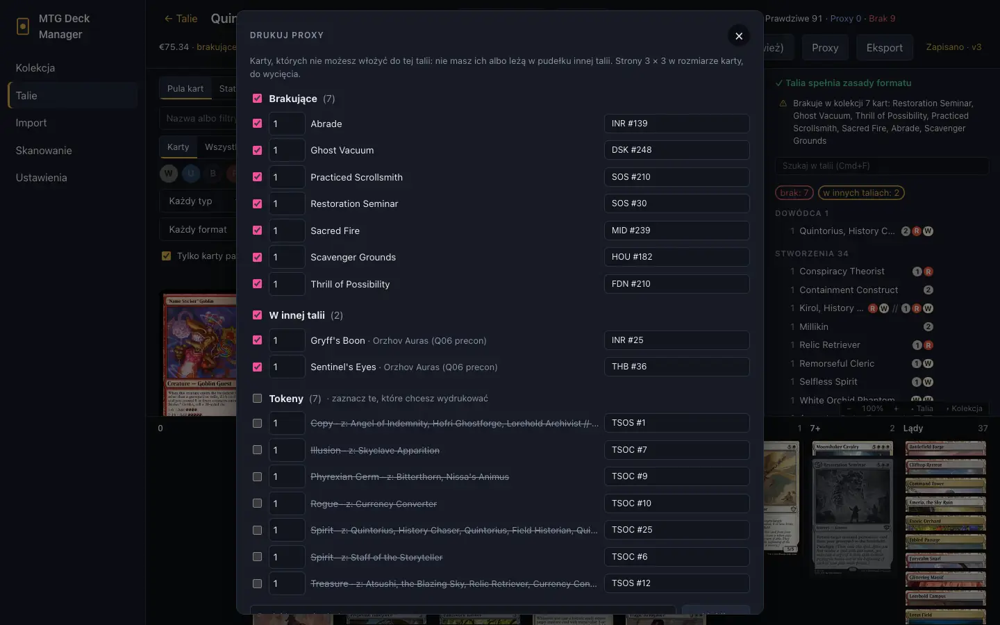
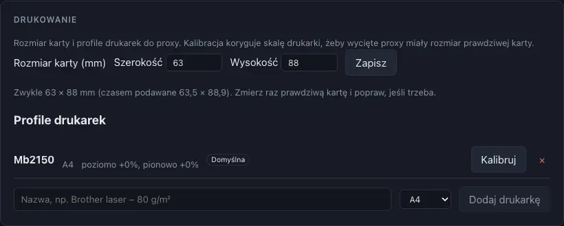

# Drukowanie proxy

[← Spis treści](index.md)

Proxy służą tylko do testowania talii we własnym gronie, nie na sprzedaż.

## Proxy z talii

W talii papierowej przycisk **Proxy** otwiera listę kart, których nie możesz włożyć do jej
pudełka:
- **Brakujące:** nie masz ich;
- **W innej talii:** twoje kopie leżą w pudełku innej talii (z jej nazwą);
- **Tokeny**, które talia tworzy;
- **Dodane ręcznie:** dowolne inne karty.

Wybierz ilości i wydania, a potem ustaw wydruk:
- **papier** A4 albo Letter, 3 × 3 karty na stronę, **odstęp** i **znaczniki cięcia**;
- **wygląd:** obrazy kart ze Scryfalla (bez zmian) albo **proxy tekstowe**, które oszczędzają tusz:
  nazwa, koszt, typ, tekst, statystyki i cena w cienkiej ramce;
- **dwustronnie:** u karty dwustronnej druga strona trafia na tył, a inne karty dostają tył
  aplikacji;
- **profil drukarki** z [kalibracją](#kalibracja-drukarki).

Po wydruku aplikacja proponuje zapisać wydrukowane karty jako proxy w pudełku talii.

## Proxy z kolekcji

Inne karty i tokeny wydrukujesz z **Kolekcja → Drukuj proxy**. Karty dodasz:
- zaznaczając je w siatce (**Zaznaczaj do druku**);
- prawym przyciskiem → **Dodaj do druku proxy**;
- wyszukując je w oknie albo wklejając listę.

## Proxy w talii

Proxy jest częścią talii, ale nigdy nie liczy się jako twoja karta:
- deckbuilder oznacza takie karty etykietą PROXY, a nagłówek pokazuje
  `Prawdziwe · Proxy · Brak`;
- zakładka **Braki** pokazuje je osobno, jako „pokryte przez proxy – do kupienia”;
- **Kolekcja → Proxy** pokazuje każde proxy z jego talią i informacją, czy masz już prawdziwą
  kartę. Proxy możesz zastąpić prawdziwą kartą po zakupie (albo przenieść luźny egzemplarz),
  przenieść, usunąć albo wydrukować ponownie.

*(zrzut z angielskim interfejsem)*

## Kalibracja drukarki

Drukarki lekko skalują i przesuwają wydruk. **Ustawienia → Drukowanie**:
- **Rozmiar karty (mm):** zwykle 63 × 88; zmierz prawdziwą kartę i popraw, jeśli trzeba;
- **profile drukarek:** wydrukuj stronę kalibracyjną i zmierz linijką dwie długości. Kolejne
  wydruki wyjdą w prawdziwym rozmiarze karty, więc wycięte proxy zmieszczą się w koszulkach;
- przy druku dwustronnym strona testowa pokazuje, o ile drukarka przesuwa tył względem przodu
  (odczyt pod światło na skali 0,5 mm), a aplikacja koryguje to przesunięcie.

Drukuj w skali 100% („Rzeczywisty rozmiar”), bez „Dopasuj do strony”.
