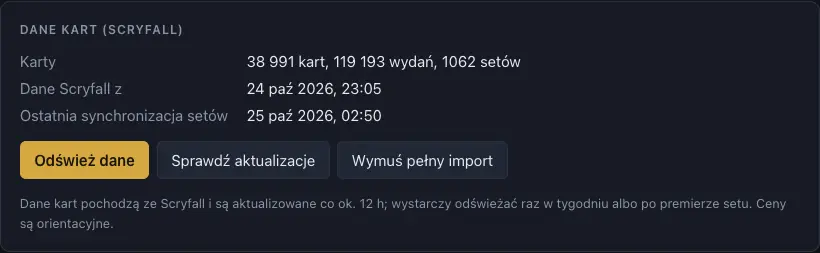

# Ustawienia i kopie zapasowe

[← Spis treści](index.md)

## Język

**Język / Language**: polski albo angielski. Zmiana przeładowuje aplikację.

## Rozmiar interfejsu

Powiększa całą aplikację: teksty, przyciski i karty, np. na dużym monitorze. Wybierz od 80% do 200%
albo użyj skrótów **Cmd/Ctrl +** i **Cmd/Ctrl −** (**Cmd/Ctrl 0** wraca do 100%). Aplikacja
pamięta rozmiar, tak jak inne ustawienia widoków (układ deckbuildera, grupowanie, rozmiar kart). W
przeglądarce (`mtgdm serve`) zamiast tego działa powiększenie przeglądarki.

## Dane kart (Scryfall)

- **Pobierz dane kart / Odśwież dane:** pobiera karty ze Scryfalla (ok. 80 MB), funkcje kart (tagi
  Scryfalla) i listy preconów. Odświeżaj raz w tygodniu albo po premierze dodatku.
- **Sprawdź aktualizacje:** sprawdza, czy Scryfall ma nowsze dane.
- **Wymuś pełny import:** importuje karty ponownie, nawet gdy dane się nie zmieniły.

Ceny ze Scryfalla mają do doby opóźnienia, dlatego aplikacja pokazuje je jako orientacyjne.

## Kopia zapasowa

- **Zapisz kopię:** zapisuje kolekcję, lokalizacje, talie (z historią wersji), listę zakupów,
  twoje tagi i profile drukarek do jednego pliku JSON. Danych kart ze Scryfalla w niej nie ma (da
  się je pobrać ponownie). Tokenu CardTradera też nie ma.
- **Wczytaj kopię…:** przywraca kopię i dodaje ją do tego, co jest. Z zaznaczonym **zastąp obecne dane (zamiast dodawać)**
  najpierw usuwa obecne dane. Uszkodzony plik niczego nie zmienia.

### Automatyczna kopia w chmurze

W sekcji **Kopia zapasowa** wybierz folder, który synchronizuje iCloud Drive, OneDrive albo
Dropbox (aplikacja podpowiada znalezione). Po każdej zmianie aplikacja zapisuje tam
`mtgdm-backup.json`, a starsze kopie trafiają do `history/`.

Na drugim komputerze z tym samym folderem aplikacja zaproponuje wczytanie nowszych danych (swoje
najpierw zapisze w `history/`) albo pozostanie przy swoich. Niczego nie nadpisuje bez pytania.

## Drukowanie

Rozmiar karty i profile drukarek do proxy: [kalibracja drukarki](proxies.md#kalibracja-drukarki).

## CardTrader

Token API i język kart na wishliście: [CardTrader](buying.md#cardtrader).

## Aplikacja

Folder danych, rozmiar bazy, wersja aplikacji i sprawdzanie nowych wersji, które można tu wyłączyć.
